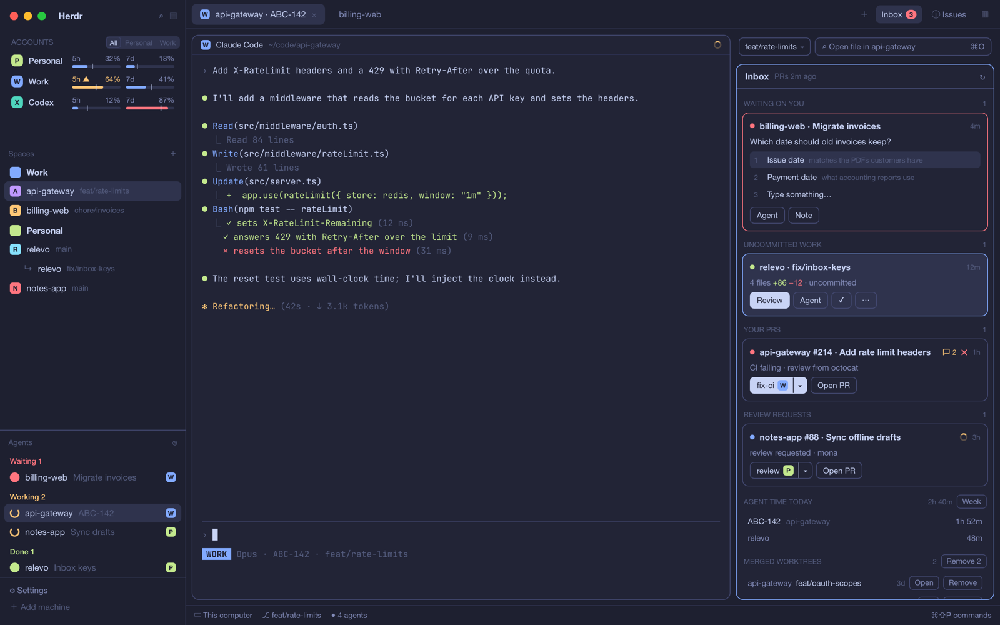
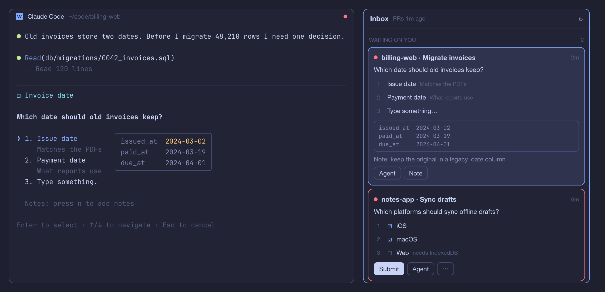
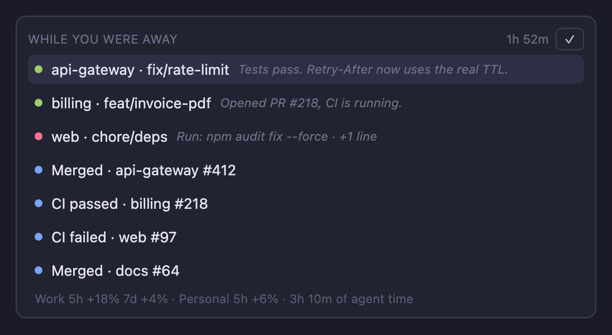
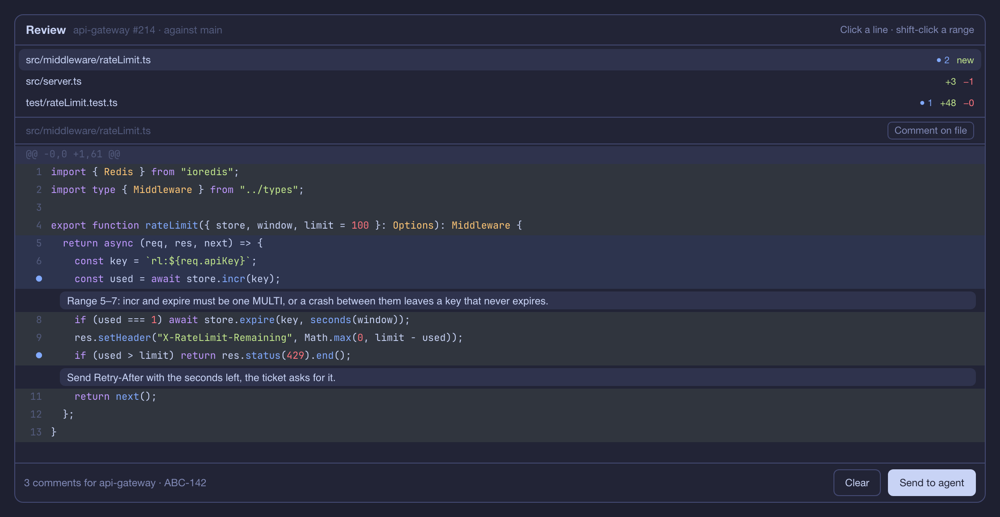
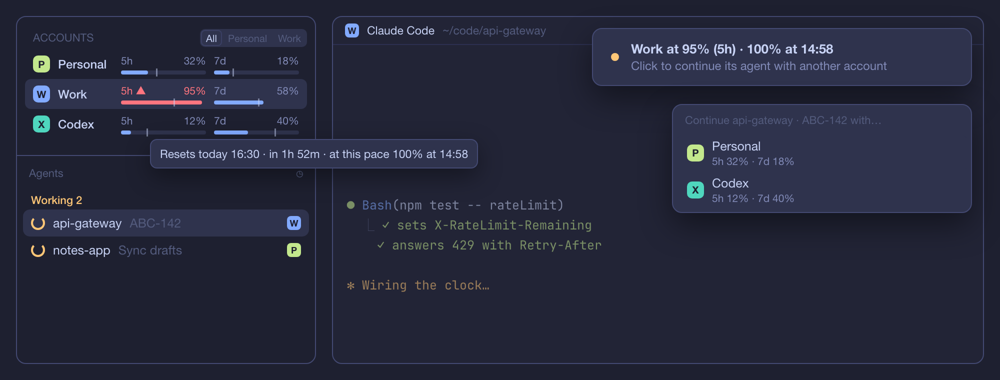
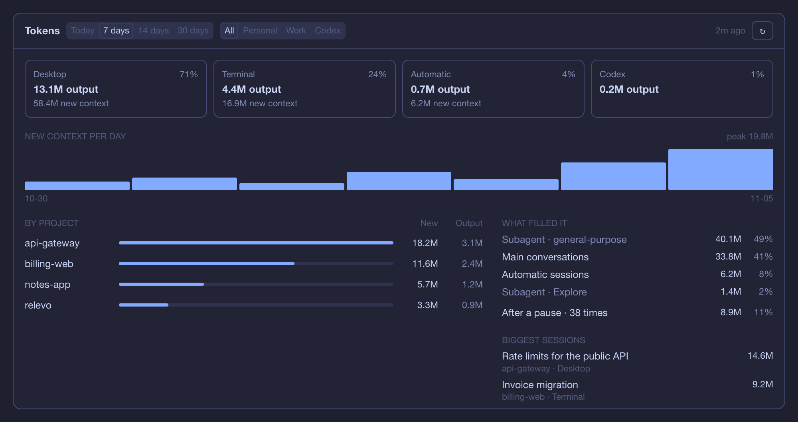
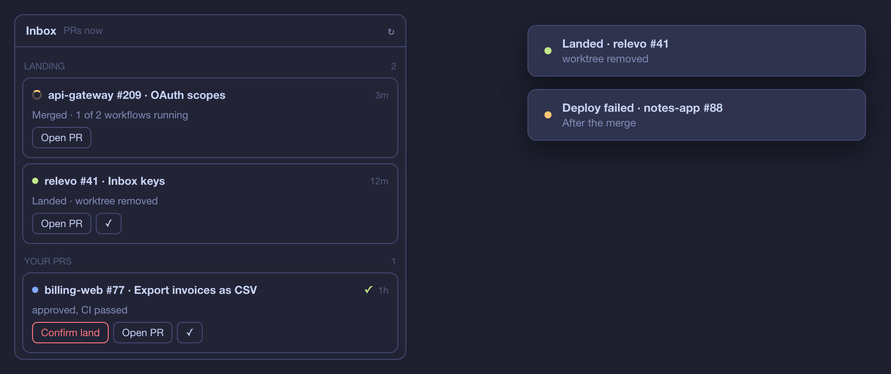
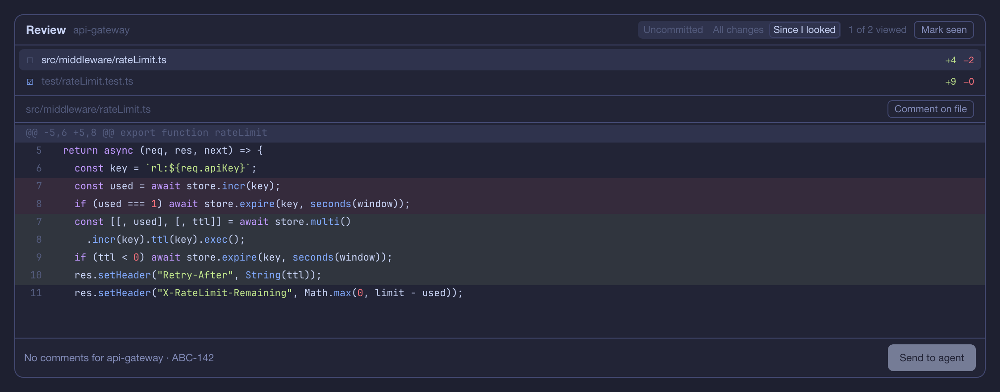
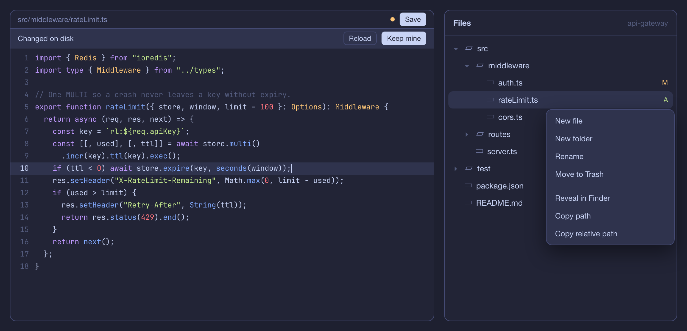
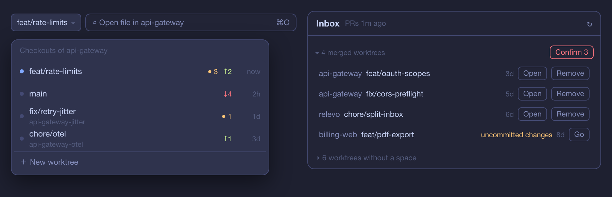

# Relevo

A Herdr layout for running coding agents across several Claude accounts: quotas per account, an Inbox where
you answer agents waiting on you and triage pull requests, uncommitted work and merged worktrees, a review pane
for local changes or whole PRs that sends line, range and file comments to the agent, handoffs between accounts,
alerts when a PR's CI or reviews change, and a ledger of agent time per ticket.



*The preview and screenshots are mockups with demo data, drawn to match the layout.*

## Live goals in the existing Inbox

Choose **Goals** in Inbox to group PRs and local changes by an explicit goal, owner and priority. Link existing agents as leads and attach revision-bound screenshot/video links while retaining Relevo's review, reply, CI and Land controls. **Classic** switches back immediately. Goal metadata persists separately and does not grant approvals or send messages automatically.

Track a goal's plan through pending, working, review and manually validated steps; pause, close or reopen it explicitly. Drafts and addressed work keep their original controls in expandable groups. See the [product goal and acceptance plan](docs/proposals/relevo-goal.md) for the complete scope and remaining work.

Click the **Inbox** heading to focus its queue: **↑/↓** selects work, **G** reaches the next goal, **E** opens context, **S** opens the existing skill/account picker, and **R** opens review where available. **?** shows help; **Tab/Shift-Tab** moves between controls. Enter activates the focused control. Goal cards keep secondary **Criteria and feedback** in a keyboard-accessible fold while decisions, evidence and work controls stay visible. The goal editor separates **Decision**, **Plan** and **Ownership**, retains edits across sections, and saves with **⌘S**. Skills still run through the existing account and worktree flow. See the [keyboard interaction guide](docs/proposals/goal-ux.md).

See [installation, rollback and current limits](docs/proposals/decision-inbox.md). The reversible installer preserves accounts, layouts, keys and sessions and creates a standalone rollback launcher. Lead/coordinator automation, voice and preference learning are follow-up work in this PR.

## Native Decision Inbox preview

Try the goal-aware Inbox inside the real Herdr app, in an isolated local profile with fictional data. See the [native preview instructions](docs/previews/native-decision-inbox.md). It keeps the existing Inbox and does not change your installed configuration or connect to real agents.

To inspect your actual saved workspace/tab metadata without connecting the preview to live agents, use the separate [local metadata snapshot](scripts/SNAPSHOT.md). It keeps real names and relationships, marks missing goals and states as unknown, and does not import accounts or credentials.

## What it does

### Answer agents without leaving your work

A waiting agent's question shows in the Inbox with its choices, its preview and a note field. Click a choice and
the agent continues; multiple choice gets a Submit. Any other time, `⌥⌘S` sends a message or one of your saved
replies, like "commit and push". `⌥⌘E` finds a past session of this repo and resumes it with its account.



### See what happened while you were away

Back after ten minutes or more, a card at the top of the Inbox lists which agents finished and what they said last,
which ones wait for you, what changed on your PRs and how much quota and agent time went. Click a row to go there.



### Review a whole PR, then hand the comments to its agent

Click a line or shift-click a range, comment, and **Send to agent**. Your PR cards open the PR against its base even
when the branch isn't checked out.



### Never stop at 100%

Each quota bar says when it runs out at the current pace. Click an agent's account chip, or press `⌥⌘A`, to continue it
with another account; an alert offers the same at 95%. Between Claude accounts the next one resumes the same conversation; to or from Codex it starts from a note
with the last screen and the working tree. `⌥⌘N` starts a new agent on the Claude account with the most room left.



### See where your tokens go

`⌥⌘U` opens **Tokens**: output and new context by surface (Claude Desktop, terminal, automatic sessions, Codex),
project, subagent type and day. It reads the transcripts on your Mac and sends nothing anywhere.



### Claude Desktop sessions too

Desktop sessions that ask you something or wait for a review show in the Inbox and the Agents list, one click from
Desktop. With Herdr behind another app, alerts reach macOS; with `terminal-notifier`, a click lands on the agent.

### Land a PR, and review only what changed

**Land** merges a ready PR at the commit you saw, follows the workflows the merge starts and removes its worktree
when nothing would be lost. In the review pane, **Since I looked** shows only what the agent changed after your
last look, and **Viewed** marks files until they change.





### Resolve conflicts, and see what each turn cost

A PR with merge conflicts offers **resolve conflicts**: an agent in a worktree of its branch that merges the base
and pushes without `--force`, then watches CI until it passes. When an agent's turn ends, a receipt says what it took and how much went to
subagents; a heavy one gets an alert.

### Edit files in the panel

Right-click in Files to create, rename, trash, reveal or copy a path. Edit a preview and save with ⌘S; a change on
disk while you edit asks **Reload** or **Keep mine**, so nothing is overwritten silently.



### Every checkout, one click away

The panel bar's selector lists every checkout of the repo with uncommitted files, ahead/behind and last use. Merged
worktrees that are safe to remove go in one Confirm. When your PR merges, the toast takes you to its worktree.



## Install

1. Install the two community mods it uses: [space-folders](https://github.com/jankeesvw/herdr-space-folders)
   and [issues](https://github.com/jankeesvw/herdr-issues) (from herdr.dev, or copy their folders into
   `~/.config/herdr-app/mods/`).
2. Copy `layouts/relevo.json` and `layouts/relevo.svg` to `~/.config/herdr-app/layouts/` and `mods/relevo`, `mods/relevo-agents`,
   `mods/relevo-files` and `mods/relevo-tabs` to `~/.config/herdr-app/mods/`. Merge `keys.json` into yours.
3. Switch to the layout (`ctrl-shift-l`) and open Settings (the gear beside ACCOUNTS): your accounts, the GitHub
   orgs that use each one, and where your clones live. It writes `mods/relevo/config.js`, which you can also edit.

It needs `git` and the GitHub CLI (`gh auth login`) on your PATH, and `claude` and optionally `codex`.

Waiting agents' questions are answered from the Inbox for Claude Code and Codex. Codex only asks them in Plan mode;
outside it, it decides on its own.

## Update

Herdr doesn't update mods from others, and adding Relevo again installs a renamed second copy, so copy the new files
over the old ones. From a clone of this repo:

```sh
rsync -a --exclude config.js mods/relevo/ ~/.config/herdr-app/mods/relevo/
rsync -a mods/relevo-agents/ ~/.config/herdr-app/mods/relevo-agents/
rsync -a mods/relevo-files/ ~/.config/herdr-app/mods/relevo-files/
rsync -a mods/relevo-tabs/ ~/.config/herdr-app/mods/relevo-tabs/
cp layouts/relevo.json layouts/relevo.svg ~/.config/herdr-app/layouts/
```

Mods reload by themselves. `--exclude config.js` keeps your accounts; copying that file over yours resets them. Don't add `--delete`: it removes your own icons. Compare
`keys.json` with yours and add what's new. Relevo's keys now live in a `layout:relevo` section; if yours are under
`global`, move them so they only act while Relevo shows.

## What it reads and runs

- Runs `git`, `gh`, `hc`, `find` (to look for repos in a worktree's ignored folders) and the launchers in `config.js`; Files runs `/usr/bin/trash`, `open -R`, `mv -n` and `mkdir`.
- Reaches the network for quotas: each Claude account's login from the macOS Keychain goes to Anthropic's usage
  endpoint, and Codex's `~/.codex/auth.json` to ChatGPT's. It never refreshes or writes a token.
- Reads each Claude account's `history.jsonl` to rank the skills a PR's menu offers (counts only), its short
  one-line prompts to suggest quick replies you keep typing, and its sessions for `⌥⌘E`, with the title, branch and
  PR from the end of each session file (in memory, never written anywhere).
- Reads every Claude account's `projects/` transcripts and Codex's `~/.codex/sessions` for token counts (message
  ids, models, token numbers, folders, session titles), and Claude Desktop's session files in
  `~/Library/Application Support/Claude/claude-code-sessions` (title, folder, and whether a session asks or waits for
  a review). Keeps the counts in `~/.local/state/relevo/usage/`.
- Merges, updates and marks PRs ready only when you click (`gh pr merge`, `gh pr update-branch`, `gh pr ready`), and
  re-runs failed jobs with `gh run rerun --failed`. **Save checkpoint** stores a git tree under `refs/relevo/seen/` for **Since I looked**. **Mark file viewed** and **Mark all viewed** track reviewed file contents separately.
- Shows macOS notifications with `terminal-notifier` when installed, else `osascript`.
- Writes `~/relevo-backups/deletions.log` (each worktree it removes: time, repo, path, branch and commit),
  `~/.local/state/relevo/ledger.jsonl` (agent time), `~/.local/state/relevo/replies.json` (how often you send
  each saved quick reply), `~/.local/state/relevo/addressed.json` (PRs marked
  addressed) and `~/.local/state/relevo/handoff/` (handoff notes); a PR session adds a worktree under
  `~/.herdr/worktrees/`;
  a handoff between Claude accounts copies the session file into the next account's `projects/` folder;
  the folders it adds to space-folders' file, and files you create, rename or save in Files.
- Sets a `relevo.addressed` terminal label on local work you mark addressed, and watches the git folders of repos
  with a resting agent. Its repeated git reads write nothing there.
- Optional: sounds at `~/.config/herdr-app/sounds/{quota,review,bg-done}.mp3`; quota snapshots a Claude
  statusline writes to `~/.cache/herdr-relevo/quota-<account>.json` (only when the values change, or an idle session's
  old values look new); `agent.account`, `agent.jira` and
  `agent.transcript` terminal labels from a Claude hook, for account chips, per-ticket time and resumed handoffs.
- That hook is one optional Claude hook on three events (SessionStart, Stop, SessionEnd), in bash with `jq`, and it only sets terminal
  labels: account, ticket, session file and background tasks. Without it Relevo still runs; you lose account chips,
  resumed handoffs (handoffs use the note) and the background-task marker, while ticket time falls back to the ticket
  in the branch name. To set it up, tell your agent: `Read ~/.config/herdr-app/mods/relevo/hooks/HOOK.md and follow it.`

## Tests

`node --test 'test/*.test.mjs'` from `mods/relevo` and `mods/relevo-files`, and `npx eslint@10.13.0 mods` from the root for undefined names (Node from `.nvmrc`). CI runs both on every push.

## License

Apache 2.0. See NOTICE for the parts derived from Herdr.
