# Relevo

A Herdr layout for running coding agents across several Claude accounts: quotas per account, an Inbox where
you answer agents waiting on you and triage pull requests, uncommitted work and merged worktrees, Runs that hand a
task to one agent and its review to another (to fix a pull request, get a second opinion or start from a prompt),
a review pane for local changes or whole PRs that sends line, range and file comments to the agent, Spaces by
folder, handoffs between accounts, alerts when a PR's CI or reviews change, and a ledger of agent time per ticket.

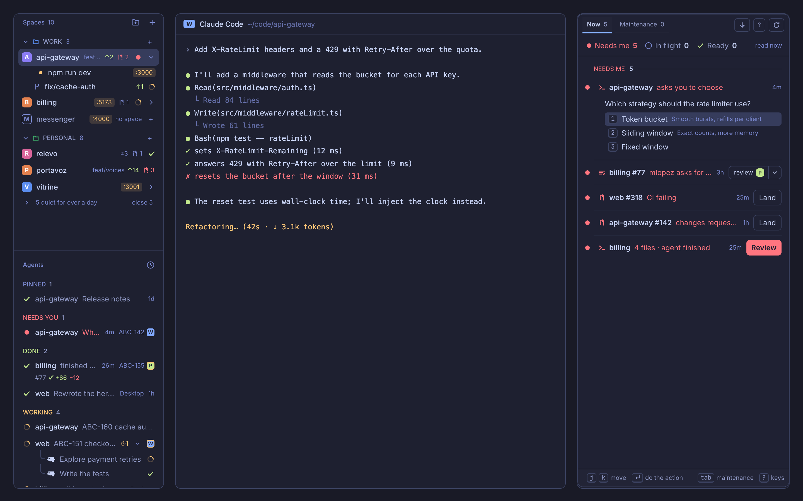

*The pictures use demo data; most are drawn from Relevo's own code with `node scripts/shots/readme.mjs`.*

## Whose turn is it?

Relevo answers one question across every agent, run and pull request: **whose turn is it?**

- **Needs me**: an agent asked, a result or decision waits, someone asked for your review, your PR is failing.
- **In flight**: agents are working, CI is running, a merge is landing. Nothing to do.
- **Ready**: one key from done: land the PR, open the Desktop session.
- **Maintenance**: everything that can wait: merged worktrees, old PRs, stale branches, agent time.

Every row reads the same way, left to right:

| lane | body | edge |
|---|---|---|
| who holds it (● needs me · spinner in flight · ✓ ready) | what it is and the one reason it is here | its age and the one action |

Select a row for the rest: its checks, its files, its run, and every other action with its key. `j`/`k` move,
Enter runs the main action, `1`–`9` answer an agent, `x` selects in Maintenance, `?` lists every key. Relevo is
Spanish for relay: the work passes between you and your agents, and the list always says who is holding it.

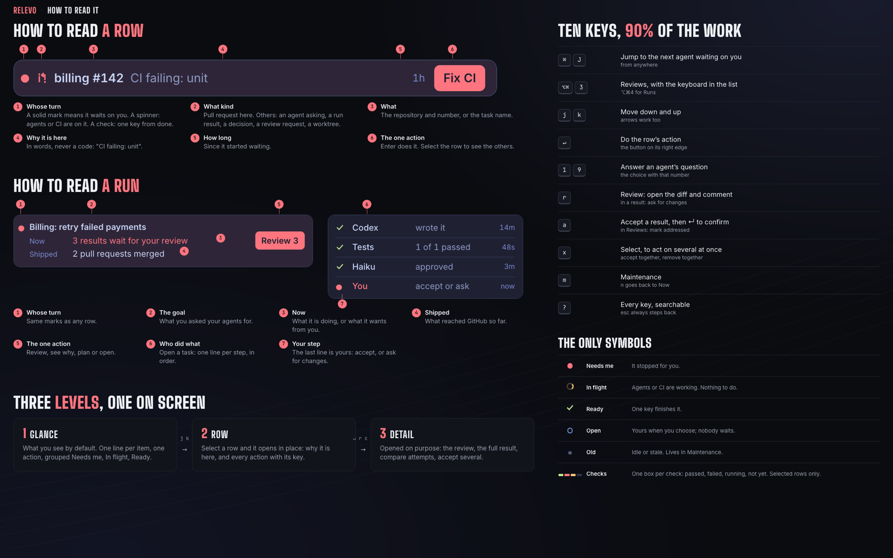

## Runs: hand a task to two agents

The panel has two views. **Reviews** is the Inbox described below. **Runs** is for work you hand off: one agent writes it, your tests run, a second agent reviews it, and the result waits for your decision.

1. **New run** (`n`) takes a prompt. Its first line names the run.
2. Check the repository, the tests, who writes it and who reviews it; they come filled in. The repository is the one you are in (a run's worktree gives the repository it came from), the tests are what it declares (the `test` script of `package.json` with npm, pnpm, yarn or bun, `go test ./...`, `cargo test`, `pytest` or `make test`), and the agents are the ones you used last unless one is out of quota. The line above the setup reads it all, for example "app · own worktree · Team → Codex · npm test".
3. **Start**. By default the run gets its own worktree, `run/<slug>` under `~/.herdr/worktrees/<repo>/`, and its writer opens there in a tab. The reviewer opens in a second tab when the writing is done and its tests have run. If an agent asks whether to trust the new folder, Runs shows it under Needs me with **Trust and continue**. **Existing sessions** uses agents you already have open in the repository instead.
4. The result appears under **Needs me**, in Reviews with its agents, attempt, tests, verdict and age, and in Runs on its run. Open it to read where it stands in one line, the writer's summary, the files it changed and who did what. **Review** (**D**, or a click on a file) opens the change beside the panel. Then accept (**A**, then Enter: **Accept and open draft PR**) or ask for changes (**R**). **Ask to fix** on a reviewer's finding marks it, and **Send feedback** asks the writer for every marked finding, whole, with your note. Accepting the last open task takes you back to Runs, on that run. A run the agents could not finish shows as **Stuck**; **See why** opens it on the reviewer's finding.

**Fix a pull request with a run.** On a PR of yours with failing CI, changes requested or unresolved comments, **Fix with a run** writes the prompt from GitHub (the failing checks and each unresolved comment with its file and line, since the agents work offline) and opens the run window on a copy of the PR's branch. You check it and press Start. **Accept and push to <branch>** commits the result and adds it to the pull request in one click; the push is never forced, so a branch that moved on GitHub refuses it and **Push to <branch>** stays to try again.

**A second opinion.** On an agent's row in Reviews with uncommitted work, **Second opinion** opens a reviewer of another provider beside it (Codex for Claude's work, Claude for Codex's), runs the repository's tests on the work as it is and sends the reviewer the diff. The agent whose work it is gets nothing; the verdict waits in Runs under Needs me, and only if you ask for changes do they go to that agent.

**Runs at a glance.** Each run is one row that answers three questions: what it is, what it is doing or wants **Now** ("3 results wait for your review", "stuck: the reviewer rejected it twice", "an agent is writing …", "needs a plan before agents start") and what it **Shipped** ("2 pull requests merged: #38, #42", "nothing yet"). Runs are grouped Needs me, In flight, Ready and Not started, with the counts as a legend and one action at the edge: **Review 3**, **See why**, **Open** or **Plan**. A click selects a run and shows **Edit**, **Close** and **Plan** (`e`, `c`, `p`); a second click or Enter opens it. A fix run sits under the deep review it came from, and a finished run says when it finished, newest first. Closed runs fold under "N older finished runs": **Archive** (`a`) or **Delete** one, or **Archive all**; runs closed over a week ago archive themselves, and **Saved setups** opens in place with one row per setup (name, repository, agents, attempts): **Start** fills a new task in the run window with it, and **×** removes it.

**A run opens in the panel.** Enter or a click shows its tasks under Needs me, Stuck and In flight, with the ones not started or done folded. A stuck task, selected, says **Why** in the reviewer's words. One whose writer is still its own offers **Try again**: one more try in the same worktree, with the findings you mark (all of them if you mark none) and a note. **Prepare a follow-up** starts a new task from the repository instead. Enter on a task shows the summary, each step with its check (who wrote it, the tests, who reviewed it, then you) and the decision, with one line on what accepting does. Esc goes back a level.

**What a run cost.** Under the summary of an open run, one line: agent minutes and tokens, each against the run's cap when it has one (a band that turns red at the cap; a cap never stops anything), attempts used, checks passed and pull requests shipped, with **Pause automation** or **Resume automation** at the edge. Tokens are counted for worktree runs, from the same report as the Tokens dialog.

**Attempts, side by side.** A selected task lists its attempts: who wrote it, who reviewed it, how long it took and how it ended. When a task was written more than once, **C** compares the attempts (the last three): what the reviewer said, tests, files changed, time, tokens and your note. **See what changed between them** lists the files that differ between the last two attempts.

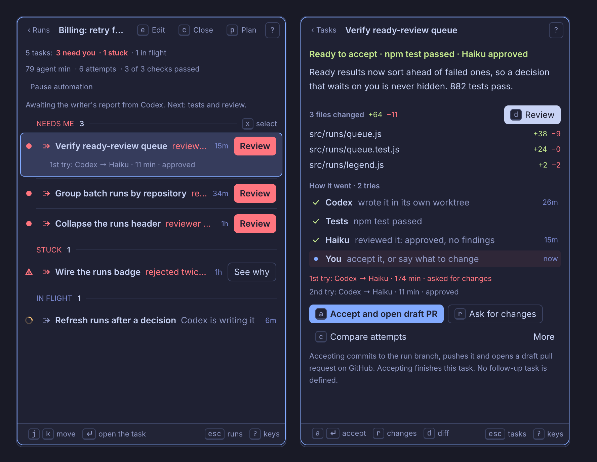

**Accept several together.** In an open run, **x** selects a result that waits on you and **X** every result of the same repository. The bar at the foot says what holds for all of them ("all approved, all tests pass") or what does not; **Enter** accepts them at the revisions on screen and **Esc** cancels. Results of two repositories are never accepted together.

**Run it again.** An accepted or cancelled task offers **Re-run with changes…**, which opens a new task in the run window with its prompt, repository, agents and limits; nothing is sent until you start it.

The separate run window is for planning (prompt, repository, agents, plan) and for the deep views a task links to: **More** opens its full report, evidence and activity, where you can also defer or add a note.

**What accepting does.** In a worktree run, acceptance commits exactly the tree the reviewer saw to the run branch, without running hooks. Anything changed after the review stays uncommitted. The button says **Accept and open draft PR**: it also pushes the run branch and opens a draft pull request whose description is the expected outcome, what the writer changed, the checks, the review and what nobody verified. A repository without an origin, or a failing `gh`, keeps the commit and says why; set `RUN_DRAFT_PR = false` in `config.js` to only commit. A run that fixes a pull request pushes onto it instead. **Remove worktree** keeps a branch that has commits. A cancelled run offers **Discard worktree**. Accepting never approves, merges or pushes anything by itself.

**Files a worktree needs.** A new worktree has only tracked files. List the ignored files a run needs, such as `.env`, in a `.worktreeinclude` at the repository root, in `.gitignore` syntax; they are copied into each run's worktree.

**What a run agent can touch.** Its worktree and its own report, nothing else. Codex runs with `workspace-write`; set `RUN_CODEX_MODEL` in `config.js` to choose its model. Claude runs Bash in the system sandbox, which it can't leave, so its commands there run without asking; its file tools cannot edit Relevo's state, mods or settings, and writing its progress and report never asks. A Claude reviewer has no shell at all and starts without your hooks; a Codex reviewer never stops to ask, so what your hooks or instructions start outside its sandbox just fails.

**Starting a run.** A new worktree makes Claude and Codex ask whether to trust it. Runs shows that under Needs me with **Trust and continue**, which answers yes in the agent's tab; nothing is trusted without that click.

**While it works and when it reports.** The writer says what it is doing, how far along it is and how long it thinks is left; the run shows that line. The reviewer lists its findings by level: blocker, major or minor. Only a finding at major or above sends the work back for another attempt; lower ones reach you as notes beside the result, with what the reviewer could not run or prove. Set `RUN_MUST_FIX` in `config.js` to `"blocker"` or `"minor"` to move that bar. What each agent is told lives in `mods/relevo/runtime/roles/executor.md` and `reviewer.md`.

**Limits.** Each run has a maximum number of attempts and minutes per attempt, and two runs work at a time. A message Relevo cannot confirm was delivered is never sent again: the run waits for you to look at the agent and reconcile it.

**More than one result.** **Review a batch** previews and accepts several results of one repository at once. **History** keeps finished tasks; **Archive older than 7 days** moves the ones the run no longer needs to `relevo-workflow/archive/`.

**Keys.** In Runs: **j/k** or **↑/↓** select, **Enter** opens the run or the task, **Esc** goes back, **N** starts a run, **G** goes to the next run, **W** opens the run window, **E** opens the run's details, **?** lists every shortcut. On a task: **A** then **Enter** accepts, **R** asks for changes (Command-Enter sends them), **D** opens the diff, **C** compares its attempts. In an open run: **x** and **X** select results, **Enter** accepts the selection, **Esc** cancels it. In the run window: **1–5** switch views, **N** starts a task, **P** opens the plan, and Command-Enter submits the prompt or a change request.

A run can also carry a plan of steps, an owner and a priority, and group the PRs and local changes that belong to it: **Edit**, then **Planning…**, shows them; a run that already has any of them shows them straight away. Saved setups and "Wait for earlier tasks" appear in the run window only once there is a setup or a task to use. Relevo counts on this machine how often each part of Runs is opened (`relevo.runs.uses` in its shared state: new runs, fixes, second opinions, Plan, Compare, batches, setups, planning), to keep what is used. See [how the coordinator works and its limits](docs/proposals/workflow-runtime.md), the [keyboard guide](docs/proposals/goal-ux.md) and [how to install and update](#update).

## Native Decision Inbox preview

Try the goal-aware Inbox inside the real Herdr app, in an isolated local profile with fictional data. See the [native preview instructions](docs/previews/native-decision-inbox.md). It keeps the existing Inbox and does not change your installed configuration or connect to real agents.

To inspect your actual saved workspace/tab metadata without connecting the preview to live agents, use the separate [local metadata snapshot](scripts/SNAPSHOT.md). It keeps real names and relationships, marks missing goals and states as unknown, and does not import accounts or credentials.

## What it does

### Every repo under its folder

Spaces groups your spaces by folder (one per account context, plus any you add with the folder button) and gives each
repo one row: its branch when it is not main, how far it is ahead or behind, how many files changed and whether an
agent there needs you. A worktree sits under its checkout. Drag a space onto a folder to keep it there. The list
order is the spaces' order, so Herdr's `⌃1`…`⌃9` go to the row you see.

Every space shows what runs in that repo: each command that runs, listens on a port or failed (Restart, Stop
and Close on hover; a resting shell stays out), and servers started in other apps ("vite in Ghostty :5173"). Agents and Claude sessions are listed in
Agents only. Nothing is folded until you fold it: a space's chevron closes it (its port then shows on its row), and
it stays closed. A repo with a terminal or server but no space is a "no space" row in its folder, with `+` to give it
one.

The Agents list has one section per state, **Needs me**, **Done**, **Working** and **Idle**, and shows every agent;
a section folds only when you click its header.

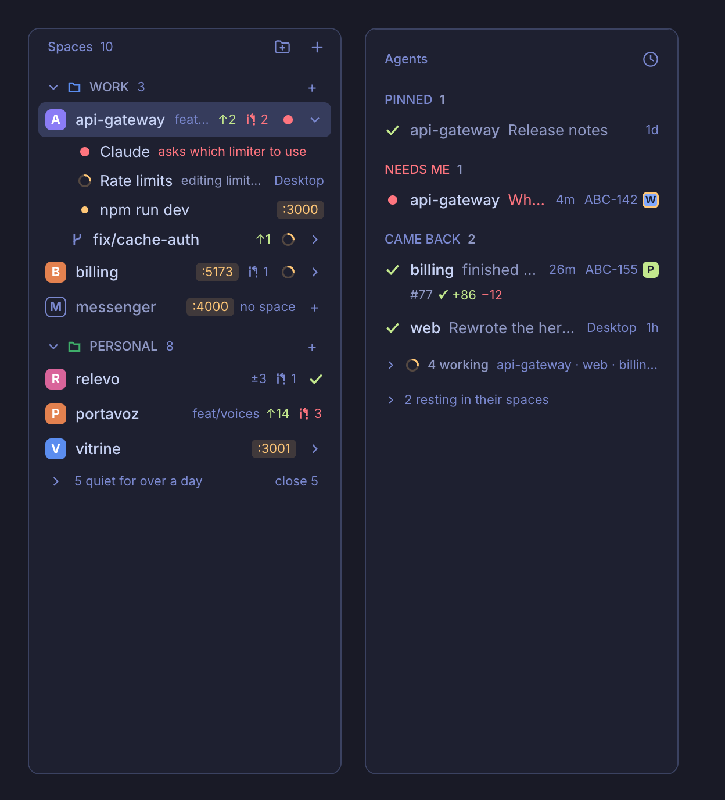

A repo's open PRs in Reviews show on its row, red when one needs you; a click opens Reviews showing only that repo.
Spaces with nothing going on for over a day go to the end of their folder under "3 quiet for over a day", which folds
them on a click and offers **close 3** (it asks once more). Nothing closes on its own.

### Answer agents without leaving your work

A waiting agent's question shows in the Inbox with its choices, its preview and a note field. Click a choice and
the agent continues; multiple choice gets a Submit. Any other time, `⌥⌘S` sends a message or one of your saved
replies, like "commit and push". `⌥⌘E` finds a past session of this repo and resumes it with its account.

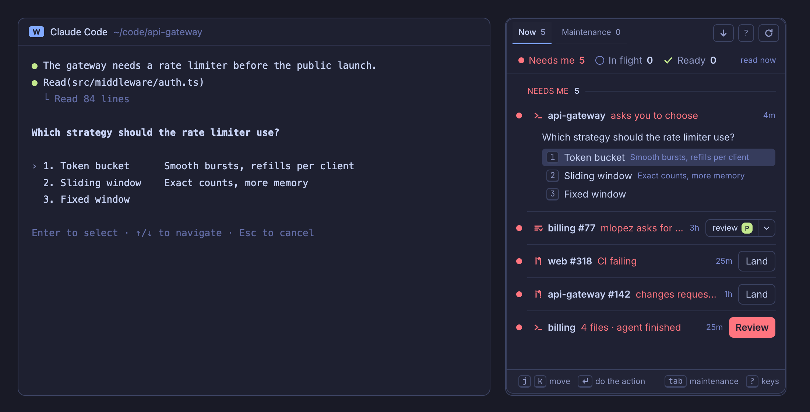

### See what happened while you were away

Back after ten minutes or more, a card at the top of the Inbox lists which agents finished and what they said last,
which ones wait for you, what changed on your PRs and how much quota and agent time went. Click a row to go there.

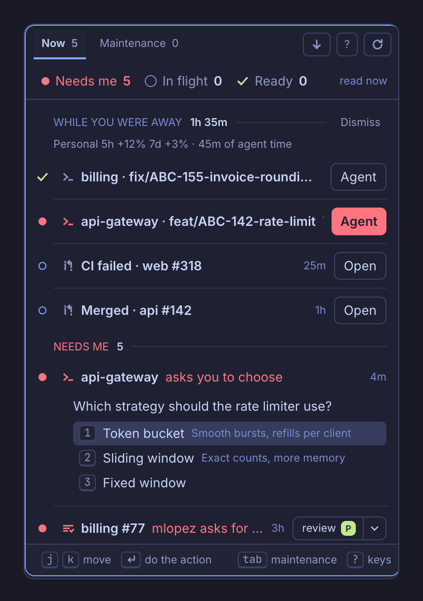

### Review a whole PR, then hand the comments to its agent

Click a line or shift-click a range, comment, and **Send to agent**. Your PR cards open the PR against its base even
when the branch isn't checked out.

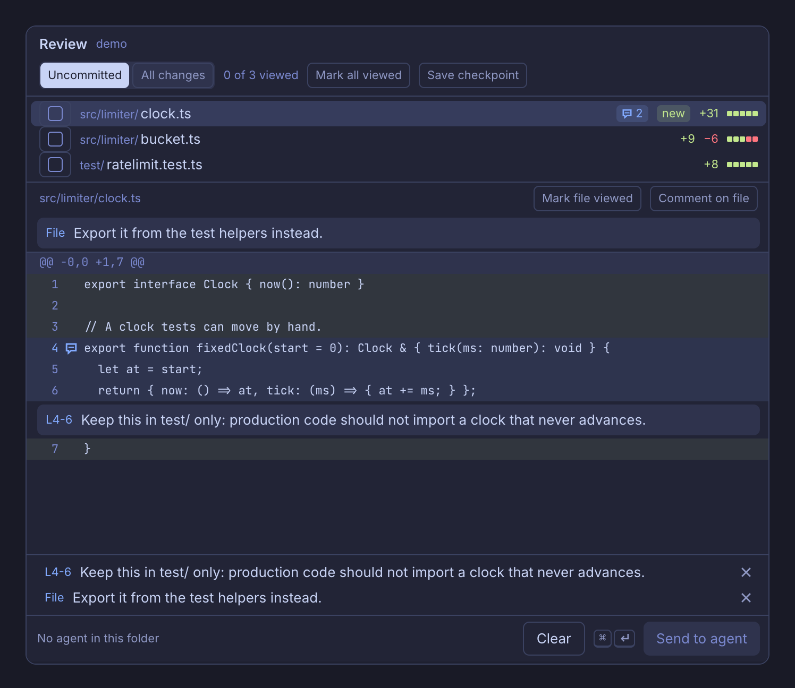

### Never stop at 100%

Each quota bar says when it runs out at the current pace. Click an agent's account chip, or press `⌥⌘A`, to continue it
with another account; an alert offers the same at 95%. Between Claude accounts the next one resumes the same conversation; to or from Codex it starts from a note
with the last screen and the working tree. The popup shows how much room each account has left and which of the two it will do; a number key picks one. `⌥⌘N` starts a new agent on the Claude account with the most room left.

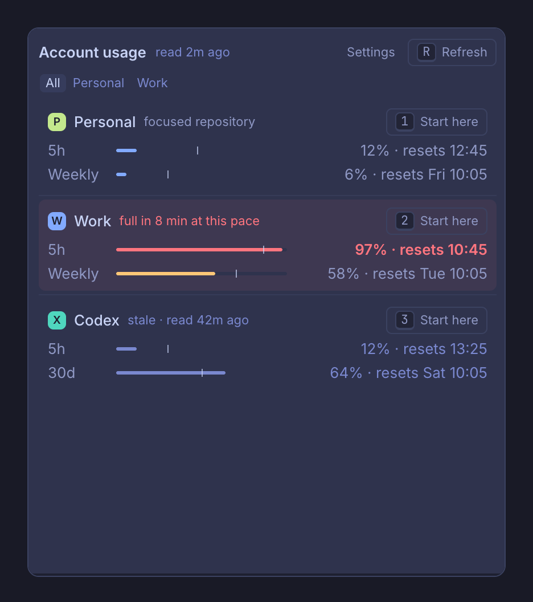

### See where your tokens go

`⌥⌘U` opens **Tokens**: output and new context by surface (Claude Desktop, terminal, automatic sessions, Codex),
project, subagent type and day. It reads the transcripts on your Mac and sends nothing anywhere.

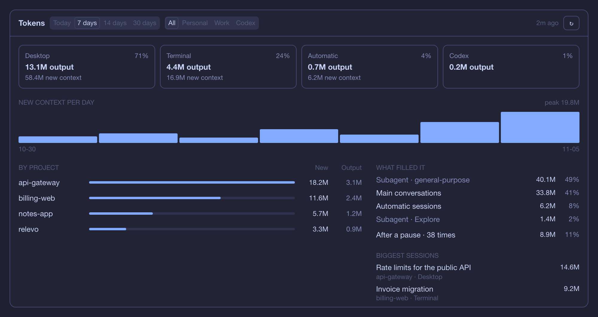

### Claude Desktop and other terminals too

Claude Desktop sessions that ask you something or wait for a review show in Reviews and in the Agents section of their state,
and so does Claude Code started in Terminal, iTerm, VS Code or any terminal outside Herdr. Each says what it is
doing or asks, and a click opens its last message in place, with **Open in Claude Desktop** or **Show <app>**. With Herdr behind another app, alerts reach macOS; with `terminal-notifier`, a click lands on the agent.

### Land a PR, and review only what changed

**Land** merges a ready PR at the commit you saw, follows the workflows the merge starts and removes its worktree
when nothing would be lost; the card reads "Landing…" from the confirming click and stays a minute once landed. The
review pane colors code by language and, with nothing uncommitted, opens on the branch's changes. **Since I looked**
shows only what the agent changed after your last look, and **Viewed** marks files until they change.

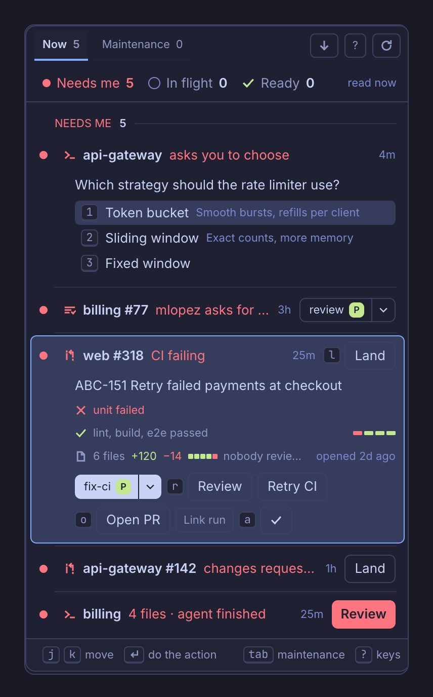

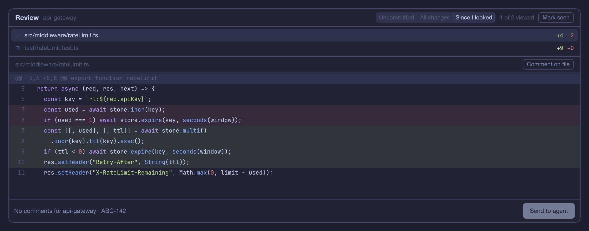

### Deep review a pull request

**Deep review** on a PR of yours opens a dialog with one line per reviewer, up to six (two by default): its account, its
model (the ones it used here lately first) and its effort. "Remember for next time" keeps the choice, and Settings › Deep
review is the base. Each reviewer reads the whole PR against its base, in a worktree of its exact head, with the
repository's tests and the PR's checks on GitHub, and closes its tab once it reports. Their findings meet in Runs as one
page, merged where they agree ("Both"): **Post as draft review** leaves them on GitHub as a pending review for you to edit
and send, and **Fix with a run** starts a run at once that gives every finding a verdict (Fixed, False positive, Won't fix
or Needs your call). The fix sits under its review and reads against it: "1 of 2 majors handled · 1 left", what it handled
and the minor notes, with **Ask to fix** on what is left. Accepting it pushes to the PR's branch. A fix that runs out of
tries offers **Try again**, one more try in the same worktree with the findings you mark. The ▾ beside **Deep review**
runs the review skills you use most, such as `/code-review`, on the PR. Codex is offered only where it is installed and on.

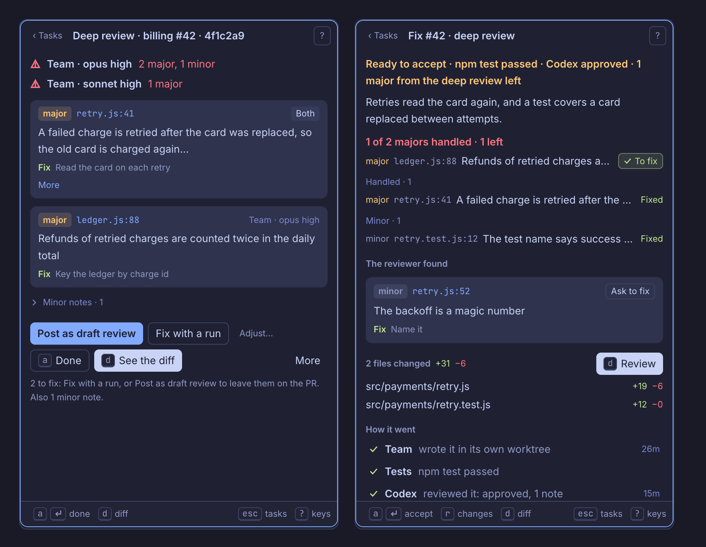

### Resolve conflicts, and see what each turn cost

A PR with merge conflicts offers **resolve conflicts**: an agent in a worktree of its branch that merges the base
and pushes without `--force`, then watches CI until it passes. Past 90% of its quota, the repo's account hands the
skill to the one with the most left. When an agent's turn ends, a receipt says what it took and how much went to
subagents; a heavy one gets an alert.

### Edit files in the panel

Right-click in Files to create, rename, trash, reveal or copy a path. Edit a preview and save with ⌘S; a change on
disk while you edit asks **Reload** or **Keep mine**, so nothing is overwritten silently.

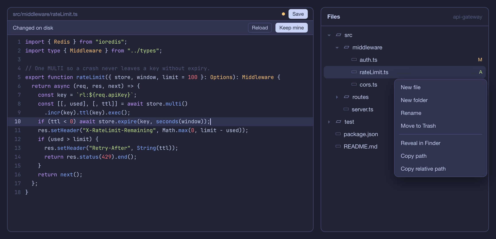

### Every checkout, one click away

The panel bar's selector lists every checkout of the repo with uncommitted files, ahead/behind and last use. Merged
worktrees that are safe to remove go in one Confirm. When your PR merges, the toast takes you to its worktree.

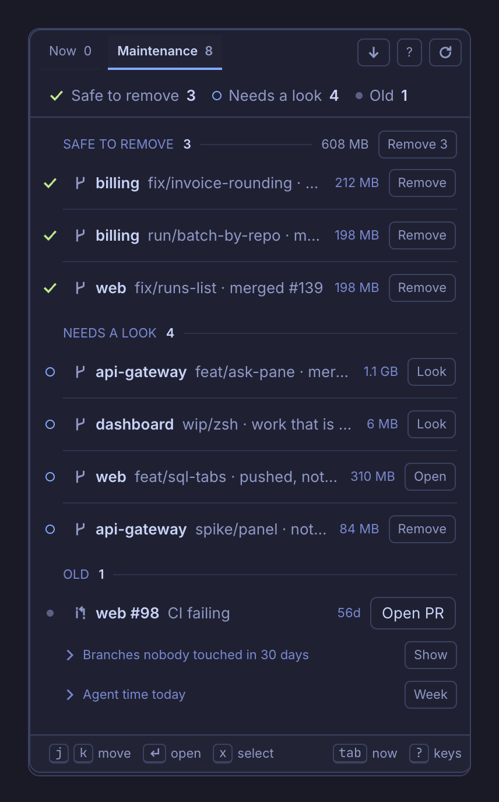

## Install

1. Install the community mod it uses, [issues](https://github.com/jankeesvw/herdr-issues) (from herdr.dev, or copy
   its folder into `~/.config/herdr-app/mods/`).
2. From a clone of this repo, run `./install.sh --dry-run` to see what it would do, then `./install.sh`. It copies the
   five mods and the layout into `~/.config/herdr-app`, creates `mods/relevo/config.js` and adds the keys you don't
   have to `keys.json`; a key you already use stays yours. It needs Node (see `.nvmrc`).
3. Switch to the layout (`ctrl-shift-l`) and open Settings (the gear beside ACCOUNTS): your accounts, the GitHub
   orgs that use each one, and where your clones live. It writes `mods/relevo/config.js`, which you can also edit.

It needs `git` and the GitHub CLI (`gh auth login`) on your PATH, and `claude` and optionally `codex`.
`node scripts/relevo.mjs doctor` checks the installed files, the keys and those programs, and says what is missing.

Waiting agents' questions are answered from the Inbox for Claude Code and Codex. Codex only asks them in Plan mode;
outside it, it decides on its own.

## Update

Herdr doesn't update mods from others, and adding Relevo again installs a renamed second copy. From a clone of this repo:

```sh
git pull --ff-only
./install.sh
node scripts/relevo.mjs doctor
```

Mods reload by themselves. An update replaces only the files it installed and you left alone. A file you changed stays,
with the new one beside it as `<file>.new`; your `config.js` and your own icons are never touched. Whatever it replaces
goes to `~/.config/herdr-app/relevo-install/backups/`, which keeps the ten newest installs. The first run over files
you copied by hand replaces them, with that backup. `node scripts/relevo.mjs uninstall` removes what it installed and you didn't change.

`doctor` also says what is left for you: the hook, when an account's copy is missing or outdated (the warning gives the
command), and the space-folders mod, which Spaces replaces since 0.8.0 with the same folders. This is the way to update
any earlier install, including one made with `scripts/live-relevo.mjs`, which installs only `mods/relevo`.

Relevo's keys live in a `layout:relevo` section; if yours are under `global`, move them so they only act while Relevo
shows.

## What it reads and runs

- Spaces runs `git rev-parse`, `git rev-list` and `git status --porcelain` in each space's folder, with optional locks
  off so it never holds `index.lock` while an agent commits.
- Every 10 seconds while the window is in front it runs `lsof -iTCP -sTCP:LISTEN`, `ps -ax -o pid,ppid,comm` and
  `lsof -d cwd` for the listening processes, to show each terminal's ports and servers started in other apps under
  your home folder. Nothing is written.
- Runs `git`, `gh`, `hc`, `cat` (the hook's notes of a permission the screen cuts), `find` (to look for repos in a worktree's ignored folders) and the launchers in `config.js`; Files runs `/usr/bin/trash`, `open -R`, `mv -n` and `mkdir`.
- Reaches the network for quotas: each Claude account's login from the macOS Keychain goes to Anthropic's usage
  endpoint, and Codex's `~/.codex/auth.json` to ChatGPT's. It never refreshes or writes a token.
- Reads each Claude account's `history.jsonl` to rank the skills a PR's menu offers (counts only), its short
  one-line prompts to suggest quick replies you keep typing, and its sessions for `⌥⌘E`, with the title, branch and
  PR from the end of each session file (in memory, never written anywhere).
- Reads every Claude account's `projects/` transcripts and Codex's `~/.codex/sessions` for token counts (message
  ids, models, token numbers, folders, session titles), and Claude Desktop's session files in
  `~/Library/Application Support/Claude/claude-code-sessions` (title, folder, and whether a session asks or waits for
  a review). Keeps the counts in `~/.local/state/relevo/usage/`.
- Merges, updates and marks PRs ready only when you click (`gh pr merge`, `gh pr update-branch`, `gh pr ready`), and
  re-runs failed jobs with `gh run rerun --failed`. **Save checkpoint** stores a git tree under `refs/relevo/seen/` for **Since I looked**. **Mark file viewed** and **Mark all viewed** track reviewed file contents separately.
- The installer (`install.sh`, `scripts/relevo.mjs`) writes only inside the Herdr app folder: the mods, the layout, the
  keys it adds to `keys.json`, and `relevo-install/` (a sha256 of each file it installed, and backups of what it replaced).
- Runs keep their state in `~/.config/herdr-app/relevo-workflow/` (tasks, attempts, agent reports and status lines, evidence up to 100 MB, and the archive) and run metadata in `~/.config/herdr-app/relevo-goals.json`. While a run is working, a coordinator (`node`, started with `hc run --bg`) sends each agent its task with `hc send`, runs the checks you configured in the run's checkout with your login shell's PATH (read once from `zsh -ilc`), and exits after ten minutes with nothing left to do. A worktree run adds a worktree under `~/.herdr/worktrees/` and a `run/…` branch; it commits to that branch only when you accept, and pushes it and runs `gh pr create --draft` only when you click **Open draft PR**.
- Shows macOS notifications with `terminal-notifier` when installed, else `osascript`.
- Writes `~/relevo-backups/deletions.log` (each worktree it removes: time, repo, path, branch and commit),
  `~/.local/state/relevo/ledger.jsonl` (agent time), `~/.local/state/relevo/replies.json` (how often you send
  each saved quick reply), `~/.local/state/relevo/addressed.json` (PRs marked
  addressed) and `~/.local/state/relevo/handoff/` (handoff notes); a PR session adds a worktree under
  `~/.herdr/worktrees/`;
  a handoff between Claude accounts copies the session file into the next account's `projects/` folder;
  the folders in `~/.config/herdr-space-folders.json`, and files you create, rename or save in Files.
- Sets a `relevo.addressed` terminal label on local work you mark addressed, and watches the git folders of repos
  with a resting agent. Its repeated git reads write nothing there.
- Optional: sounds at `~/.config/herdr-app/sounds/{quota,review,bg-done}.mp3`; quota snapshots a Claude
  statusline writes to `~/.cache/herdr-relevo/quota-<account>.json` (only when the values change, or an idle session's
  old values look new); `agent.account`, `agent.jira` and
  `agent.transcript` terminal labels from a Claude hook, for account chips, per-ticket time and resumed handoffs.
- That hook is one optional Claude hook on four events (SessionStart, Stop, SessionEnd, PermissionRequest), in bash with
  `jq`. On the first three it only sets terminal labels: account, ticket, session file and background tasks. On a
  permission request it writes what the agent asks (the tool and its whole input, such as a command) to
  a file per request under `~/.local/state/relevo/asks/<terminal>/`, readable only by you, removed after a minute or when the turn ends; it never answers
  the request. Without it Relevo still runs; you lose account chips, resumed handoffs (handoffs use the note) and the
  background-task marker, ticket time falls back to the ticket in the branch name, and a command or plan longer than the
  agent's screen shows as "Can't read all of what this asks" instead of whole. The card only uses a note when it is the one request noted as the wait began and its end is
  exactly what the screen still shows. To set it up, tell your agent: `Read ~/.config/herdr-app/mods/relevo/hooks/HOOK.md and follow it.`

## Tests

`node --test 'test/*.test.mjs'` from `mods/relevo` and `mods/relevo-files`, `node --test 'scripts/tests/*.test.mjs'` from the root (the installer, into throwaway folders), and `npx eslint@10.13.0 mods` from the root for undefined names (Node from `.nvmrc`). CI runs both on every push.

## License

Apache 2.0. See NOTICE for the parts derived from Herdr.
