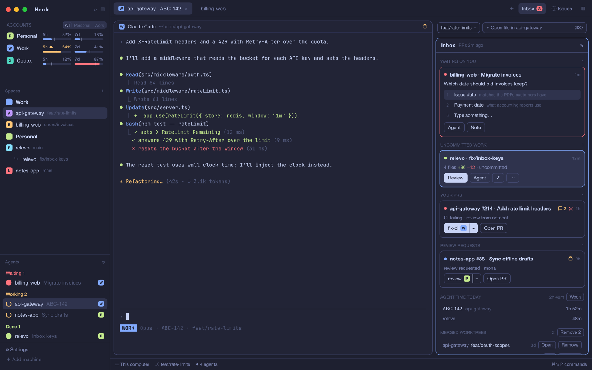

# Relevo

A Herdr window for someone who runs coding agents on several Claude accounts at once. The left sidebar shows
each account's 5-hour and 7-day quota above the spaces and agents; the tab bar gains an Inbox button with a
count; a right panel holds the Inbox (agents waiting on you, uncommitted agent work, pull requests that need
something, merged worktrees, agent time today), the Files and Changes panels and Issues. From the Inbox you open
a review pane that sends line comments to the agent, launch PR skills with the right account, and hand an agent's
task to another account.

## What you see

- **Sidebar** (`chrome`, 268px, collapses to a 44px rail): the Herdr brand row (46px); **Accounts** (158px): a
  header `ACCOUNTS` with an `All | Personal | Work` focus picker, then one 30px row per account and Codex: a
  17px rounded chip in the account's colors with its letter, the label (80px), and two meters (5h, 7d) with the
  percentage, a 4px bar (accent under 50%, `ansi3` from 50%, `blocked` from 80%) and a pace tick where the
  window's time is. Below 160px wide it becomes a rail of chips, each with one 3px bar for the fuller window.
  Then space-folders' spaces and the agents list (equal weight), and Herdr's footer (69px).
- **Tab bar** (42px): Herdr's tabs, an **Inbox** button (92px) with a red count badge, the issues button (78px)
  and a panel toggle (44px, `panel.svg`).
- **Right panel** (380px): a panel bar (66px) with the branch chips of the focused checkout and an
  "Open file in …" finder field (`⌘O`), over a stack of Inbox, Files, Changes and Issues.
- **Inbox**: a rounded (10px) list with a 36px header `Inbox · PRs <age>` and ↻. Groups, each under a 10.5px
  dim header with its count:
  - `WAITING ON YOU`: a card per blocked agent, red border, "waiting for you", **Go to agent**.
  - `UNCOMMITTED WORK`: a card per resting agent whose checkout has changes: files, `+adds −dels`, buttons
    **Review**, **View diff**, **Files**, **Agent**.
  - `YOUR PRS` and `REVIEW REQUESTS`: cards (9px radius) with a dot, `repo #n · title`, an unresolved-threads
    badge (speech bubble + count, `ansi3`), a CI badge (✓ `ansi2`, ✕ `ansi1`, spinning ring `ansi3` while
    running), the age, why it is here ("CI failing", "changes requested", "review from …"), a split skill button
    (`skill` + account chip | ▾) and **Open PR**. PRs older than 45 days fold under "▸ N older than 45 days".
  - `AGENT TIME TODAY` with a **Week** button: one row per ticket (or repo) with today's time.
  - `MERGED WORKTREES`: one 30px row per worktree whose branch merged: repo, branch, age, **Open**/**Go**,
    **Remove**. "▸ N worktrees without a space" folds the rest.
- **Review pane** (opened beside the terminal): header `Review · <folder>`, the changed files (max 150px) with
  comment counts, the diff of the open file with old/new line numbers, green and red rows, and a footer
  "N comments for <agent>" with **Clear** and **Send to agent**.
- **Week dialog** (720×460): `Agent time · week of <date>` with ‹ › and **Copy**, a table of tickets × Mon–Sun
  plus total, today's column in the accent color.
- **Handoff popup** (300px): "Continue <tab> with…" and every other account with its quota.

## How it behaves

- **Agent status**: blocked agents become `WAITING ON YOU` cards; a working agent's checkout is left alone until
  it rests; done and idle agents with changes show under `UNCOMMITTED WORK`. A card's age is how long that status
  has lasted.
- **Accounts**: a click on a row starts that account's launcher in the focused folder. Hovering a meter shows when
  the window resets. Every 30 s it rereads the statusline snapshots; every 5 min it asks the usage endpoints.
  At 80% and again at 100% a quota plays `sounds/quota.mp3` and posts a toast; at 100% the toast hands off that
  account's focused, waiting or working agent.
- **Focus picker**: `All`, or one context: the Inbox shows only that context's repos, its space folder unfolds and
  the other's folds, and alerts from the other context are muted. `⌥⌘F` cycles it.
- **Inbox scans**: an in-memory check every 1.5 s of agents and spaces; a change rescans local work or worktrees.
  Fallbacks: local work 60 s, PRs 3 min, worktrees 10 min. GitHub's merged-PR lists are cached 15 min per repo;
  ↻ skips the cache. The Inbox redraws only when a card changes.
- **PR skills**: the left part runs the skill (`/review`, `/fix-ci`, `/address-comments` by default) in a new tab
  in the repo's space with the repo's account, or the next account in `FALLBACK` when it is at 100%; ▾ picks
  another account. The card then follows that agent ("reviewing…", **Agent**).
- **Review pane**: a click on a line opens a comment field (Enter saves, Esc cancels); comments survive refreshes
  (every 10 s while you are not typing), closing the pane and restarting Herdr. **Send to agent** pastes the
  numbered comments into the agent's terminal with `hc send`. **Clear** asks once more. Review on the same
  checkout twice focuses the open pane.
- **Worktrees**: **Remove** turns into a red **Confirm** ("closes its space" when it has one); confirming closes the
  space, runs `git worktree remove` (never forced) and `git branch -d`, shows a spinning "Removing…" and folds
  the row away.
- **Inbox count**: local cards plus fresh, unseen PRs. It pulses while it is higher than when you last opened
  the Inbox.
- **Keyboard**: `⌥⌘3` shows the Inbox and gives it the keyboard (accent border); ↑/↓ select cards and rows,
  Enter runs the main action (go to the agent, review, run the PR's skill or go to its agent, open the
  worktree), Esc returns to the previous pane. `⌘J` jumps to the next agent waiting on you and says how many are
  left. `⌥⌘1–4` show Files, Changes, Inbox, Issues; `⌥⌘B` the panel; `⌥⌘D` review; `⌥⌘A` handoff;
  `⌥⌘G` the branch's PR; `⌥⌘R` respond to it; `⌥⌘W`/`⌥⇧⌘W` new or open worktree; `⌥⌘P/O/X` start an account.
  Tooltips show the key from `keys.json`.
- **Handoff**: writes a note with the agent's last 160 screen lines, `git status` and the last 5 commits, then opens
  a tab in the same folder with the other account and a prompt to read the note (the screen is marked as a
  record, not instructions).
- **Ledger**: every 3 s working agents open a stretch and stopped ones close it into
  `~/.local/state/relevo/ledger.jsonl` (`{start, end, jira, repo, branch, account}`). Parallel agents on one ticket
  count once; a stretch across midnight splits.

## Built from

- **Layout** `layouts/relevo.json`: `root` row → `sidebar` column (`brand` workspace-chrome, `accounts`
  relevo `{role: "accounts"}`, `sidebar-lists` column with `spaces` space-folders and `agents` relevo-agents,
  `sidebar-footer` workspace-chrome `{footer: true}`) and `work` column (`tab-bar` row with `tabs`,
  `inbox-button` relevo, `issues-button` issues `{button: true}`, `panel-toggle` relevo; `work-body` row with
  `main` and `panel` column: `panel-bar` relevo and `panel-body` stack of `inbox` relevo, `files`, `changes`,
  `issues`; `status` workspace-status).
- **mods/relevo**: one View that picks a part by `props().role`: `accounts`, `inbox`, `inbox-button`,
  `panel-toggle`, `panel-bar`, `account-menu`, `find-file`, `file-view`, `handoff`, `review-diff`, `ledger-week`.
  `config.js` holds accounts, contexts, fallback, `REPOS_ROOT` and skills; `lib/` holds pure helpers with
  `node --test` coverage. Only the accounts copy reads `nextCommand()`, so each `relevo.<command>` runs once.
- **mods/relevo-agents**: Herdr's agents list with account and ticket chips (from the `agent.account` and
  `agent.jira` labels and the shared `relevo.setup`).
- **Community mods**: space-folders (jankeesvw, tested at `cb83ff4`) and issues (jankeesvw).
- **herdr**: `agents`, `panes`, `spaces`, `terminals`, `focused`, `layout`, `shared`/`setShared`, `exec`, `run`,
  `notify`, `openOverlay`, `playSound`, `readTextFile`, `nextCommand`; commands `tab.new`, `space.new`,
  `space.close`, `pane.split`, `pane.focus`, `agent.focus`, `layout.select`, `layout.show`, `layout.toggle`.
- **Programs**: `git`, `gh` (GraphQL for PRs, `pr list --state merged`, `pr view`), `hc read`/`hc send`, `security`
  (Keychain), the account launchers.

## Watch out

- `setShared` redraws every copy of every mod; write only when the value changes, and never from a loop.
- Focus can't move during render: request it from render, move it in `cx.timer.after(30, …)`.
- Handlers inside `list()` item renderers throw; use the list's `on_item_click`.
- `herdr-app check` renders once and runs no handlers; a broken name inside a click handler passes it. Lint for
  undefined names.
- Herdr can't delete a shared key, only set it to null; don't use shared state for debugging.
- The diff starts at the first `@@`; the file headers before it are not rows.
- space-folders' file format is not a contract; Relevo writes `~/.config/herdr-space-folders.json` as of
  `cb83ff4`. Without space-folders the folders don't appear and the rest works.
- Quotas need Claude Code's Keychain item per config dir (`Claude Code-credentials-<sha256(dir)[0:8]>`); an
  expired token is skipped, never refreshed.
- The Inbox list doesn't scroll to the keyboard selection.
- `/fix-ci` and `/address-comments` are not built into Claude Code; provide them or change `SKILLS`.

## Done when

- The sidebar shows one row per account in `config.js` and Codex, with meters filled within 5 minutes.
- `herdr-app check mods/relevo` passes for every role (set the default role in a scratch copy).
- An agent that stops with changes shows under `UNCOMMITTED WORK` within 2 s; **Review** opens the pane, a
  comment and **Send to agent** reach the agent's terminal, and Review again focuses the same pane.
- A PR with failing CI shows "CI failing", ✕ and a solid `fix-ci` button; ▾ lists every account.
- A merged worktree's **Remove** → **Confirm** removes it with the spinner and the row folds away.
- **Week** opens the table and **Copy** pastes as a table.
- `⌥⌘3`, ↓, Enter on a waiting agent focuses that agent; Esc returns to the terminal.
- `node --test 'test/*.test.mjs'` passes in `mods/relevo`.
