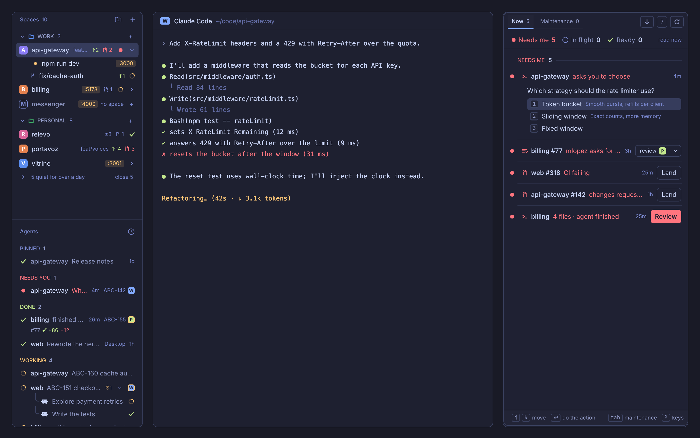

# Relevo

A Herdr window for someone who runs coding agents on several Claude accounts at once. The left sidebar shows
each account's 5-hour and 7-day quota above the spaces and agents; the tab bar gains an Inbox button with a
count; a right panel holds the Inbox (agents waiting on you, uncommitted agent work, pull requests that need
something, merged worktrees, agent time today), the Files and Changes panels and Issues. From the Inbox you open
a review pane that sends line comments to the agent, launch PR skills with the right account, and hand an agent's
task to another account.

*The preview is a mockup with demo data, drawn to match the layout.*

## What you see

- **Sidebar** (`chrome`, 268px, collapses to a 44px rail): the Herdr brand row (46px); **Accounts** (158px): a
  header `ACCOUNTS` with an `All | Personal | Work` focus picker, then one 30px row per account and Codex: a
  17px rounded chip in the account's colors with its letter, the label (92px with its chip), and two meters (5h, 7d) with the
  percentage, a 4px bar (accent under 50%, `ansi3` from 50%, `blocked` from 80%) and a pace tick where the
  window's time is. Below 160px wide it becomes a rail of chips, each with one 3px bar for the fuller window.
  Then the spaces and the agents list (equal weight), and Herdr's footer (69px).
- **Spaces** (relevo-spaces): a header `Spaces` with the count, New folder and New space; then one 26px folder header per
  folder (chevron, folder icon in its color, its name in capitals, how many spaces, `+` for a space in its folder; a click
  folds it, a right-click offers New space here, Edit folder… and Delete folder) over one 30px row per space: an 18px
  avatar, its name, then only what is unusual: a branch other than main or master, `↑2` (`ansi2`), `↓1` (`ansi1`),
  `±3` files changed, and the lane glyph of its most urgent agent. A worktree's space sits under its checkout (26px,
  tree icon, its branch). Drag a space onto another space to move it, onto a folder to put it there. The spaces' real
  order follows the list, so Herdr's `⌃1`…`⌃9` and `⌃⌘↑`/`⌃⌘↓` go through what is shown.
- **Tab bar** (42px): relevo-tabs (Herdr's tabs), an **Inbox** button (92px) with a red count badge, the issues button (78px)
  and a panel toggle (44px, `panel.svg`).
- **Right panel** (380px): a panel bar (66px) with the branch chips of the focused checkout and an
  "Open file in …" finder field (`⌘O`), over a stack of Inbox, Terminals, Files, Changes and Issues.
- **Terminals** (the third tab beside Reviews and Runs, `⌥⌘5`): every terminal that is not an agent, grouped by space,
  then **In the background** (running with no pane), **Idle over a day** and a folded **Finished** with **Close N**. A
  legend counts Running, Idle and Failed. Each row says what runs in it ("npm run dev", "zsh" with its branch), the port
  it listens on (from `lsof`, matched through the process tree) and its age. Selected, it shows its folder, branch, start
  and its last two lines, with Enter open (or **Show** for one in the background), `p` peek, `w` open its port, `r`
  restart (a terminal that runs its own command: ended, removed and started again with the same command, folder and
  name), `s` stop (Ctrl-C to a program typed into a shell), `b` to the background and `x` twice to close. Ports and
  last lines are read every 10 s, only while the view is on screen.
- **Files**: Herdr's tree with a right-click menu (New file, New folder, Rename, Move to Trash, Reveal in Finder,
  Copy path, Copy relative path). A preview, and a file opened from the finder, show **Edit**; editing adds a
  7px unsaved dot and **Save** (`⌘S`), and a change on disk shows a bar with **Reload** and **Keep mine**.
- **Inbox** (Reviews): a rounded (10px) list with two underlined views, **Now** and **Maintenance**, each with its count,
  then ?, ↻ and the focus button. Now opens with a legend, `● Needs me n · In flight n · Ready n`, and how long ago PRs
  were read; its rows are grouped by whose turn it is: NEEDS ME (agents that ask, failed landings, run results and
  decisions, review requests, your PRs with failing or cancelled CI, requested changes, threads, a conflict or a
  base to catch up with, uncommitted agent work), IN
  FLIGHT (CI running, an agent on the PR, a landing in progress) and READY (only the merge left, Desktop sessions
  ready for review), then "N waiting on others" folded (PRs you already ran a skill on, drafts). The Reviews badge is
  the Needs me count. Maintenance holds what can wait: SAFE TO REMOVE and NEEDS A LOOK (worktrees), OLD (PRs past 45 days, stale branches), one fold with
  everything marked addressed or landed (each with **Undo**) and agent time today. `Tab` switches between them (`m` goes to Maintenance), and Reviews always opens on Now. Keys: `j`/`k` or the arrows move, `g g` goes to the top and `G` to the bottom,
  Enter runs the row's action, `1`–`9` answer an agent, and on the selected row `r` reviews, `o` opens it (the PR on
  GitHub, the agent, Desktop), `a` marks it addressed (`u` takes the last one back) and `l` lands a ready PR
  (twice); the selected row shows each key beside its button. `/` filters Now by the rows' words, Esc clears it.
  Each list ends with a bar of the keys that work there and `? all keys`. In the review pane `c` comments on
  the file, `v` marks it viewed, `[` and `]` move between files, ⌘↵ sends. Each
  open group sits under a caps header with its count and a hairline. Every item is one row: the lane glyph (who
  holds it: a red disc when it needs you, the spinner while agents or CI work, a check when one key finishes it,
  a ring when it can wait), the kind glyph, what it is, the one reason it is here, its age and its one action.
  A row that needs you is tinted. A click or the arrow keys select a row: it opens in place with its other lines
  and every action, and Esc or another selection closes it. A fold you open stays open across reloads (shared
  `relevo.inbox.folds`):
  - `WAITING ON YOU`: a row per blocked agent that always shows what it asks. A permission or plan first shows its title, why and,
    in a mono block, the command, diff or plan: up to 8 lines, wrapped and never cut, then "+N more lines", which shows the rest. A yes it can't
    read in full (the start is off screen, or it recognizes no command) has no choices, only **Agent**. Then the
    question it asks (read from its screen; with no choices, its last words) and
    its choices as a list: number, a box in a multiple choice, label and dim description; the agent's cursor
    row is tinted. Its action is **Submit** when the form has one, **Reply** when it asks in words; selected, it adds **Agent**, **Note** and **Continue with…**. On a
    multi-question form's last step a gray block lists each question with its answer before "Submit answers".
  - `UNCOMMITTED WORK`: a row per resting agent whose checkout has changes: files and whether the agent finished,
    with **Review**; selected, its branch, `+adds −dels`, its last words, **Agent**, **View diff**, **Files**, **Reply** and
    **✓** (addressed). Addressed ones fold under "N addressed", each with **Undo**.
  - `YOUR PRS` and `REVIEW REQUESTS`: a row per PR, `repo #n`, why it is here ("CI failing", "changes requested",
    "<author> asks for your review", "2 comments"), its age and its first action. A PR waiting on you is a needs-me
    row; one whose CI runs or whose agent works is in flight; one with only the merge left is ready. Selected, it
    shows its title, which checks failed, are running or were cancelled by name, which passed (with one box per
    check), how many files and lines changed, unresolved threads, whether anyone reviewed it yet and when it was
    opened, what its agent did, and every action: a split skill button
    (`skill` + account chip | ▾), **Review** on your own PRs, **Open PR** and **✓** (addressed). PRs older than 45
    days fold under "▸ N older than 45 days"; addressed ones under "▸ N addressed", each with **Undo**. Your PRs
    with nothing left but the merge (CI green, not a draft, no changes requested, no open threads) fold under
    "▸ N ready to merge", outside the count.
    Your drafts fold under "▸ N drafts", each with **Ready for review** (`gh pr ready`). A PR whose merge state is
    `CLEAN` or `HAS_HOOKS` gets **Land** first; one `BLOCKED` in a repo that allows auto-merge gets
    **Land when ready**. The first click turns it into a red **Confirm land** for 4 s. `BEHIND` adds **Update branch**,
    and failed, errored or cancelled CI **Retry CI**.
  - `LANDING`, above review requests: one row per landing PR, "Merges as soon as GitHub allows it", "Merging…", "Merged · N
    of M workflows running", "<workflow> failed after the merge" (a needs-me row, **Open run**) or "Landed · worktree
    removed", with **Open PR**, **Cancel** (auto-merge off) and ✓. Done cards go after a day.
  - `IN DESKTOP`: a row per Claude Desktop session that asks something; the ones ready for review fold under "▸ N ready for review": `project
    · title`, its question or summary, its last message when selected, **Open in Claude Desktop** and ✓, which folds it under "▸ N addressed" until it does
    something new.
  - A summary row heads the list: five tiles (need you, reviews and your PRs from the last 45 days, ready, tokens today), the first with a red
    border while something waits; it runs `⌘J`, ready unfolds the ready PRs, today opens Tokens.
  - "▸ Agent time today · <total>" with **Week** on the line; open, one row per project with today's time, tickets included. The name and the time, nothing else.
  - **Maintenance** also lists TERMINALS TO TIDY, from the same records as the Terminals tab: a command that failed
    ("exited 1", **Restart** when the terminal runs its own command), one row for the finished ones (**Close N**), what
    runs with no pane for over an hour (**Show**) and shells idle over a day (**Close**). `d` closes one, pressed twice.
  - **Maintenance** opens with its own legend, `✓ Safe to remove n · ○ Needs a look n · • Old n`, and lists every
    merged worktree and every worktree without a space as a row: repo, branch and the one reason, its size (`du -sk`)
    and one action. SAFE TO REMOVE holds merged worktrees that are clean, unlocked, unused for a day and have no
    ignored files to keep ("merged #38"); its header shows the group's total size and **Remove N** when more than
    one has no space. Each row has **Remove** → **Confirm** ("closes its space" when it has one). NEEDS A LOOK holds
    everything else that is not in use: "not merged, nothing to lose" (no changes, no commits outside the main
    branch, no ignored files to keep, 7 days unused; its own **Remove** on the row, never part of a batch), "merged, but has files git ignores", "merged,
    but has uncommitted changes", "work that is not saved anywhere" (uncommitted or unpushed), "work saved in
    Backups, not on GitHub", "pushed, not merged" (**Open**; GitHub must still have the commit for its Remove),
    locked or unreadable; their action is **Look**, which selects the row. "▸ N recent · checking N" folds the ones
    used lately (a merged one for a day, "merged #38 · used 22m ago"; a loose one for 7 days) and the ones still being
    read. Loose worktrees are read once Maintenance has been opened. A selected row says what removing it would
    lose: "Merged as #212 3d ago, so the code is safe. Removing the folder also deletes 3 things git never saw:" with
    up to five of those files in a block and "+N more"; and its other actions with their keys: `s` **Save patch** (a
    patch verified to rebuild the same tree, through a copy of the index) or **Save commits** (a verified bundle),
    **Push backup** (to `backup/<worktree>`, never forced; asks first with the real push URL, "Publishes N commits
    to public <repo>" unless it's a private repo on github.com, then pushes the commit it showed, asking again if
    anything changed), **Open**/**Go**, `o` **Open folder** and `d` **Delete forever** or **Remove**. Remove reads
    the state again and stops if the row changed; on a clean row with ignored files it is called Delete forever,
    names them and waits for **Confirm**. On a row with work, Delete forever (idle 7 days, not open, locked or
    holding a repo) first says what would be lost, then reads again; `worktree remove --force`, the only forced
    removal, and `branch -D`. `d` only asks; Enter or the button answers, Esc takes the question back.
  - **Several at once**: `x` selects the focused worktree and `X` every one in Safe to remove that has no space
    (**Remove N** does the same); selected rows show a checkbox at the edge. A bar at the foot of the list says "N
    selected · <size>" with `esc` **Cancel** and `d` **Remove N**. Remove N asks once, in a card in place of the bar:
    "Remove N merged worktrees?" with what holds for the selection (whether they are merged, how many spaces close,
    "Nothing unsaved is lost. Logged in deletions.log."), `esc` **Cancel** and `↵` **Remove N**. Then each row goes
    through the same look-again as its own Remove (the day-of-use rule included), never forced; one that gained
    ignored files, a space, a terminal or changes stays, selected, with the reason on its row, and a toast counts
    what went. A batch only ever takes merged worktrees: a selection holding any other row can't be removed, and the bar names it.
  - "▸ N branches nobody touched in 30 days" closes OLD, with **Show**. Opened (and on ↻ while open) it reads each
    clone's local branches with `git for-each-ref`, 15 minutes per repo, and lists those whose last commit is older
    than 30 days and that are not the default branch nor checked out anywhere: branch, "last commit 52 days ago",
    "gone upstream". **Delete branch** runs `git branch -d`, never `-D`, and shows git's refusal as git wrote it. Clones are read four at a time; one git
    can't read gets its own line, "Couldn't read branches in <repo>" with **Retry**, and is never counted as having none.
  - Backups go to `~/<BACKUPS_ROOT>/<repo>/<worktree>/<time>/`, private, with `latest.json` telling whether what's
    here is saved. A **Backups** row shows the folder's size and **Open**, once it exists. Each worktree Remove or
    Delete takes adds a JSON line to `~/<BACKUPS_ROOT>/deletions.log`: time, what the row said, repo, path, branch
    and commit.
  - At 300 px or less the Maintenance legend keeps glyphs and counts, and rows drop their size; the actions stay.
- **Review pane** (opened beside the terminal): header `Review · <folder>` with an **Uncommitted | All changes**
  picker (or `<repo> #n · against <base>` for a PR), the changed files (max 150px), a bar with the open file and **Comment on file**, the
  diff with old/new line numbers, green and red rows, and a footer "N comments for <agent>" with **Clear**, the
  `⌘` `↵` keycaps and **Send to agent**. A file row is the viewed checkbox, the folder dimmed (11px) before the
  file name, then on the right an accent tag with the comment icon and the count, a green **new** tag on a file the
  diff creates, `+adds` `−dels` (a zero side is left out) and five squares split between them; a binary file has a grey **binary** tag instead. In the diff, the
  line where a comment starts has the comment icon beside its number and the lines of a range are tinted
  (`accent` at 12%); the saved comment is a box under its last line: `L5-7`, `L12` or `File` in accent and the
  text. Above the footer, the open file's saved comments are listed one per line (max 96px, scrolls), a click opens one for editing, its × deletes it.
- **Tokens dialog** (880×620, `⌥⌘U`): a header with Today / 7 / 14 / 30 days and the accounts, the age of the last
  read and ↻; four 76px tiles per surface (share of the output, output, new context); new context per day as bars in
  one hue, with the peak; **By project** with a bar, new context and output; **What filled it** (main conversations,
  automatic sessions, each subagent type, the rest together, and "After a pause · N times"); **Biggest sessions**
  with title, project and surface. While a read runs it shows "Reading N%".
- **Agents list additions**: one line per agent: a glyph for whose turn it is (a filled 8 px disc in `blocked` needs
  me, the spinner in `working` is in flight, a check in `done` has finished), the name, then what it is doing or needs
  in muted text (the waiting reason in `blocked`, "result ready", "writing #43", "finished #40"), the age when it rests
  and the account chip. The focused agent has a full 1 px `accent` outline over `selected` and a second line: PR tag
  with CI and size, `Opus 5.5`, a context band and `273k`, `· cache 48m` (`ansi3` under 10 minutes, "cache gone"
  after), machine and folder. Priority groups are **NEEDS ME** (asking, or a result not yet seen, both with the disc and `blocked` text), **IN FLIGHT** and
  **IDLE**, each with its count; IDLE shows three and folds the rest ("4 more idle"). A ✓ on hover settles an idle or
  done agent under a folded **SETTLED** group; a **CLAUDE DESKTOP** group lists Claude Desktop sessions working, asking or
  ready for review, and **ELSEWHERE** the Claude Code sessions in terminals outside Herdr (Terminal, iTerm, VS Code,
  Ghostty…) that the hook noted, with the app's name. Each reads like an agent: what it is doing now ("editing ui.js"),
  what it asks, or its last words, from the end of its local transcript. A click opens its last message in place, with
  **Open in Claude Desktop** or **Show <app>**.
- **Settings dialog** (800×700, the gear beside ACCOUNTS): accounts (chip preview, label, letter, launcher, Claude
  dir, colors), Codex's launcher, contexts (label, account, orgs), fallback order, repos root and skills; Save.
- **Week dialog** (720×460): `Agent time · week of <date>` with ‹ › and **Copy**, a table of tickets × Mon–Sun
  plus total, today's column in the accent color.
- **Handoff popup** (340px): "Continue <tab> with…", then one 46px row per account, Codex included: a number
  keycap, the chip, the label over a thin band of its tightest window, and on the right "88% room" (100 minus that
  window) over how the work continues: "same conversation" between Claude accounts, "from a note" to or from Codex.
  A full account is dimmed, says "full · resets 23:00", has no number and can't be picked; the account being left is
  last, dimmed, with "this is the one you leave". `1`–`9` pick a numbered row.
- **Account status** (status bar block, 440px, min 150): one item per account and Codex, a chip and a ring of 20
  dots for its tightest window; a click opens the usage popup. Six states, each also in the item's accessibility
  label: the focused repository's account adds its name; from 50% the ring is `ansi3`, with no number; from 80% the
  item is tinted and adds the percent, and "resets 23:00" from 360px; a reading older than 30 min has a dim ring and
  its age ("42m"); an account with no reading has an empty ring with "?"; at 150px or less only chips and rings show.
- **Account usage popup** (420px, up to 500px tall): a header with "Account usage", the age of the newest reading
  ("read 2m ago"), **Settings** and **Refresh** (`R`); the focus picker; then one section per account, with
  hairlines between them. A section has the chip, the label, one note and a numbered button; under it a "5h" and a
  "Weekly" row (the window's real length when it is longer, "30d"), each a band with a pace tick and "12% · resets
  16:40", in `blocked` from 80%. The note is the first that applies: "stale · read 42m ago", "full in 9 min at this
  pace" (`blocked`, when a window fills within the hour), "focused repository", "weekly window is the tight one"
  (the long window is the fuller and at 50% or more). A section at 80% or over is tinted. An account with no
  reading shows "Usage unavailable · no reading yet" instead of the rows. The button is **Start here**, or
  **Continue with…** when the account is at 95% or over and has an agent to move, which opens the handoff. `1`–`9`
  press that section's button.

Text is 11px for what supports a row and 13px for what it names; a test keeps it to those two. Glyphs are the SVG files in `mods/relevo/icons/` (12 px grid), colours are theme tokens only, and the shared row grammar is in [docs/design/v6.md](docs/design/v6.md).

## How it behaves

- **Agent status**: blocked agents become `WAITING ON YOU` cards; a working agent's checkout is left alone until
  it rests; done and idle agents with changes show under `UNCOMMITTED WORK`. A card's age is how long that status
  has lasted, kept in `localStorage` across reloads.
- **Accounts**: a click on a row starts that account's launcher in the focused folder. Hovering a meter shows when
  the window resets. Every 30 s it rereads the statusline snapshots; every 5 min it asks the usage endpoints. Each window shows the newest source that still has it. A statusline should write its snapshot only when the values change, so its date means something.
  At 80% and again at 100% a quota plays `sounds/quota.mp3` and posts a toast; at 100% the toast hands off that
  account's focused, waiting or working agent.
- **Focus picker**: `All`, or one context: the Inbox shows only that context's repos, its space folder unfolds and
  the other's folds, and alerts from the other context are muted. `⌥⌘F` cycles it.
- **Inbox scans**: an in-memory check every 1.5 s of agents, their turns and spaces; a change rescans local work or
  worktrees. So does a shell command ending in a repo, and a change to the git state of a repo with a resting agent
  (`watchFolder` on its git folder, 2 s after the last write; new objects and locks don't count). Reads use
  `--no-optional-locks` with `core.fsmonitor` and `diff.autoRefreshIndex` off, so they can't wake the watch.
  Fallbacks: local work 60 s and worktrees 10 min while the window is active, PRs 3 min. GitHub's merged-PR lists
  are cached 15 min per repo;
  ↻ skips the cache. The Inbox redraws only when a card changes.
- **PR skills**: the left part runs the skill (`/review`, `/fix-ci`, `/address-comments` by default) in a new tab
  in the repo's space with the repo's account, or the next account in `FALLBACK` when it is at 100%. The card then
  follows that agent ("reviewing…", **Agent**). ▾ opens a 320px menu: one chip per account (Codex included), the
  recommended skill and up to two other configured skills you have run, most used first ("used N×", counted from
  each account's `history.jsonl`), and **New session in a worktree of <branch>**: `git worktree add --detach` under
  `~/.herdr/worktrees/<repo>/<branch>` plus `gh pr checkout`, or the branch's existing checkout, then a space with the
  chosen account's agent and a prompt naming only the repo, number and URL (the title and branch are the author's
  text, so the agent reads them with `gh pr view`), told to wait for instructions. A fork's PR gets a local branch
  `pr-<n>`, never a checkout matched by its branch name. Someone else's fork doesn't get a session: an agent there
  could run its code, and no launch flag makes that safe, so the row is disabled.
- **Review on a PR**: uses the PR's checkout when it has one (uncommitted changes included); otherwise fetches
  `+refs/pull/<n>/head:refs/relevo/pr/<n>` and reviews that exact head, with no branch made or moved.
- **Addressed**: ✓ stores the moment in `~/.local/state/relevo/addressed.json`; the card stays out of its group and
  the count until the PR's `updatedAt` is later (a comment, review or push). On an uncommitted-work card ✓ sets the
  terminal label `relevo.addressed=<ms>:<turn>` with `hc label`; the card returns when the agent works, waits or
  starts a later turn. A label takes about 0.65 s to show, so the Inbox keeps the pending value until then.
- **Answering from the Inbox**: before any key, it reads the screen again and compares the dialog with the card as
  drawn: from the dialog's top edge, a whole solid line at the margin (the whole screen without one; a command's lines
  are indented and `╌` fences a diff), to its last choice, plus each choice's label and whether it has Submit. The
  cursor, boxes and a preview beside the choices don't count. If they differ it sends nothing, toasts "The question
  changed" and redraws the card. Reply on a card without choices only checks that no menu, whole or unparsed, has
  appeared, since the paste's Enter would pick an option. A failed or blank read of the screen sends nothing. Measured on Claude Code's menus: a single choice moves the agent's cursor
  with ↑/↓ and presses Enter; a multiple choice toggles a box with its number and **Submit** moves to Submit and presses
  Enter; the free-text choice takes the Reply field's words as a paste (in a multiple choice the cursor goes there
  by arrows and the box is checked again after the paste's Enter). The card rereads the screen after every key.
- **PR alerts**: every PR scan compares your open PRs with the last one and posts a toast when CI fails or passes,
  new review threads appear, or a PR is approved or gets changes requested (a sound on the bad ones). A PR that
  leaves the open list and shows among your merged ones says **Merged**; when its worktree is still here, the scan
  marks it at once and the toast's click opens the Inbox with that row selected, so **Remove** is right there.
- **Runs** (the same panel, `relevo.goals.mode`): a header "Runs · a run is a goal you gave your agents" with **n New run**, ?, ↻ and
  the focus button; the legend `Needs me n · In flight n · Ready n`; run rows under NEEDS ME, IN FLIGHT, READY and NOT STARTED,
  "N older finished runs" folded, a "Saved setups · n" line with **Show** that opens in place (one row per setup: name, repository · writer + reviewer · attempts,
  **Start**, which opens the run window on a new task with the setup applied, and **×**, which removes it), and a key bar at the foot. A run row is the lane
  glyph (disc needs me, warning stuck, spinner in flight, check ready, ring not started), the title, two labelled lines
  (**Now**: what it does or wants; **Shipped**: its linked PRs merged, open or draft and the draft PRs of accepted worktree
  tasks, else "nothing yet") and one action (**Review n** and **See why** filled, **Open**, **Plan**). Selected, it adds
  **Edit**, **Close** and **Plan**. Enter or a click opens the run in the panel (`relevo.goals.scope`): "‹ Runs", the title, a
  summary ("9 tasks: 3 need you · 1 stuck · 1 in flight · 1 not started · 3 done") and task rows under NEEDS ME, STUCK and
  IN FLIGHT with "N not started · N done" folded. Under the summary, the cost line (11px): a 44px band of agent minutes
  against `maxAgentMinutes` when the run has that cap (accent, `blocked` from 100%), "37 of 60 agent min", "9.1M of 10.0M
  tokens" (`maxTokens`; left out with no cap and no tokens read), "N attempts", "tests k of n passed", "N PRs shipped" and
  **Pause automation** (`stop`) or, with the engine off, **Resume automation** (`resume` for this run's paused tasks that were
  ready, running or in review). Tokens come from `report.runs`, read with `cat` and again only when `relevo.usage` says the
  scanner wrote a newer report. A task row is lane glyph, relay glyph, title, short state ("reviewer
  approved", "rejected twice, no attempts left", "<agent> is writing it"), age and **Review** or **See why**; a stuck one,
  selected, shows **Why** (the reviewer's summary and findings, else the task's error) and **Next** (**Prepare a follow-up**,
  which fills a new task in the run window). Any selected task lists its attempts as 11px lines ("attempt 2: Codex Luna →
  Team Haiku · 9 min · approved") and, written more than once, **c Compare attempts**: "‹ Tasks", the title, "took N
  attempts" and a table with a column per attempt (the last three) and the rows Reviewer said (verdict and first finding),
  Tests, Change (files +a −d), Took, Cost and Your note, then **See what changed between them** (`attempt-diff` between the
  last two attempts: up to 50 files with +/−, "+N more"; a refusal such as "No snapshot is kept for this attempt" is a muted
  line). With two or more results waiting the NEEDS ME header shows "x select": **x** toggles a result, **X** takes every
  result of the same repository, selected rows swap **Review** for a checkbox and say what accepting does next ("then:
  done"), and the foot becomes "N selected · all approved, all tests pass" (or what is not, in `blocked`), **esc Cancel** and
  **↵ Accept N** (accent): `batch` with `preview: true`, then the previewed ids and revisions with `preview: false`, then the
  "Batch accepted" alert. Enter on a task shows "‹ Tasks", the writer's summary, four rows of who did
  what (writer, tests, reviewer, you; yours tinted), what nobody verified, and the decision: **a Accept** (A or a click arms,
  Enter or a second click sends `decide` with the revision on screen), **r Ask for changes** (a text area, ⌘↵ sends; with no
  attempts left it prepares a follow-up), **d See the diff** and **More**, both in the run window; the attempts above the decision when there was more than one; and,
  on an accepted or cancelled task, **Re-run with changes…** (a new task in the run window with its prompt). Esc goes back one level.
  A merged linked PR is remembered in shared `relevo.runs.merged` once the landing list has seen it merge.
- **Run alerts**: a run result that comes to wait on you posts "Result ready · <task>" with the reviewer's verdict; the click opens Reviews with that result selected, and **Review result** there opens the task in Runs. Each result is announced once per revision and attempt, and the first read after a start only learns what already waits. Accepting several results at once posts "Batch accepted · N results" with their repository; its click opens the run. Results outside the focused context stay quiet.
- **While you were away**: back after 10 minutes or more behind other apps (or with the Mac asleep), a card tops
  the Inbox with the agents that finished (and their last line), the ones waiting, what changed on your PRs, the
  quota each account spent and the agent time. Each row goes to its agent or PR; **✓** dismisses it.
- **Sessions**: `⌥⌘E` lists past Claude sessions of the focused repo (its worktrees included), newest first, with
  title, folder, branch, PR and account; Tab switches to every repo. Typing filters, Enter resumes the session in its
  folder with its account (`--resume`). Running sessions and ones whose transcript Claude deleted aren't offered.
- **Quick replies**: `⌥⌘S`, ↩ beside an agent in the list, or **Reply** on an Inbox card opens a field with the
  replies from `config.js` (`REPLIES`, editable in Settings). The list has the keyboard: ↑/↓ and Enter, or a
  reply's number, sends it; typing moves to the field, whose Enter sends what you typed. It goes with `hc send`
  without `--force`, so it never answers a question the agent is asking. Saved replies come first, ordered by how
  often you send them (`~/.local/state/relevo/replies.json`, halving every 14 days); up to five in all, the rest are
  one-line prompts you typed at least 3 times in 90 days in the agent's context, from every account's
  `history.jsonl` (prefiltered with `grep`, read at most once an hour).
- **Review pane**: a click on a line opens a comment field, a shift-click extends it to a range, **Comment on file**
  comments on the whole file (Enter saves, Esc cancels); comments survive refreshes
  (every 10 s while you are not typing), closing the pane and restarting Herdr. A click on a saved comment's box opens it again (a
  range as a range); its × in the list above the footer deletes that comment alone and saves the rest. **Send to agent** pastes the
  numbered comments into the agent's terminal with `hc send`; `⌘↵` in the pane does the same under the same
  conditions, and in an open comment field it saves the comment instead. **Clear** asks once more. Review on the same
  checkout twice focuses the open pane. **All changes** diffs the working tree from the merge base with origin's default branch, and the message sent says so.
  **Review** on a PR diffs from the merge base with its base branch: the
  checkout's working tree, or the branch itself when it isn't checked out (fetched when not local); with no agent on
  the PR, **Send** starts one in its repo with the repo's account.
- **Tokens**: every 5 min the accounts copy lists each account's transcripts modified in 31 days with their sizes
  and reads what each added since its last size: `dd` from the 64 KiB block holding that offset, `grep` for
  assistant lines with usage and for titles, and one `awk` per batch that pulls each message's id, time, model,
  entrypoint, four token counts, cache lifetime, session and folder with `index()` lookups (regexes over lines of
  several MB took minutes). Batches stay under 100 MB and 400 files; a file over that goes in ranges overlapping by
  8 MB. A message id counts once across files, so resumed and forked sessions don't double. `entrypoint` gives the
  surface (`claude-desktop` Desktop, `cli` terminal, the rest automatic); a write over 20k tokens more than an hour
  after the previous message counts as a pause. State, ids by day and a report live in `~/.local/state/relevo/usage/`,
  read with `cat` (past `readTextFile`'s 1 MiB) and written with `writeTextFile`. Codex adds what each
  `token_count` event's total grew by.
- **Claude Desktop**: every 30 s it reads Desktop's `claude-code-sessions/*/*/local_*.json` changed in 7 days, again
  only when one changes. A session is working when its last message is newer than its last turn and something
  happened in 15 minutes, blocked when its post-turn summary says so or needs an action, review when it's
  `review_ready`. **Open in Desktop** opens `claude://code/continue?session=<id>`.
- **Alerts outside Herdr**: with the window inactive, each toast also goes to macOS: `terminal-notifier` with
  `-activate dev.herdr.app` and `-execute` running the toast's own action through `herdr-app do`, or `osascript`.
  An agent turning blocked or done gets one too, grouped by terminal and removed when it stops asking.
- **Land**: `gh pr merge <n> --<method> --match-head-commit <oid>` (the repo's `viewerDefaultMergeMethod`, else the
  first it allows; `--auto` for Land when ready); every 20 s `gh pr view` until merged, then `gh run list --commit
  <merge>`; no runs after 3 minutes counts as landed. Cleanup finds the PR branch's worktree, keeps it unless its
  HEAD is the PR's head and it passes Remove's checks (the day-of-use rule aside), closes resting agents' panes from
  other spaces, closes its space, removes it and deletes the branch with `-D` only when its tip is that head.
- **Resolve conflicts**: a PR whose `mergeable` is `CONFLICTING` gets the `conflicts` skill first. Without
  `SKILLS.conflicts` it runs a built-in prompt (merge the base, never rebase or force, ask on decisions, run the
  checks, push) in a worktree of the PR's branch through the same path as **New session in a worktree**; from ▾ the
  menu stays open, saying Opening…, until the session is open. ▾ always lists the `fix` skill beside it.
- **Turn receipts**: every 3 s the accounts copy notes each agent's status; a turn starts when it works and ends
  when it's done, idle or gone (a question only pauses it). At the start it records the sizes of the session file
  and its `subagents/*.jsonl`; at the end it reads what they gained, messages from the turn's start on, each once.
  Desktop sessions are matched to their transcript by `cliSessionId`. Receipts go to shared `relevo.turns` (40);
  one over 5M of new context plus output gets a toast.
- **Busy PR agents**: a PR whose launched agent works, waits, or has `agent.wait=watch` (something left running,
  shown from `agent.bg`) keeps its agent line and **Agent**, with no skill button and outside the count.
- **Following a form**: every 3 s, while an agent waits and no send runs, its screen is read again and the card
  redraws when the dialog, question, cursor or boxes changed.
- **Since I looked**: **Mark seen** builds the working tree as a git tree through a scratch index (`git add -A`, so
  ignored files stay out) and keeps it under `refs/relevo/seen/<hash>`; for a PR not checked out, its head. The
  scope diffs that tree against a fresh one. **Viewed** stores each file's blob hash, so a change clears it.
- **Settings**: Save validates (required fields, unique keys, the default context claims no orgs, known accounts in
  contexts and fallback) and writes `config.js` atomically; Herdr reloads the mod.
- **Worktrees**: **Remove** turns into a red **Confirm** ("closes its space" when it has one); confirming closes the
  space, runs `git worktree remove` (never forced) and `git branch -d`, shows a spinning "Removing…" and folds
  the row away. Remove N in Maintenance asks once for the lot and then does this for each row.
- **Inbox count**: local cards plus fresh, unseen PRs. It pulses while it is higher than when you last opened
  the Inbox.
- **Keyboard**: `⌥⌘3` shows the Inbox and gives it the keyboard (accent border); ↑/↓ select cards and rows,
  Enter runs the main action (go to the agent, review, run the PR's skill or go to its agent, open the
  worktree), Esc returns to the previous pane. In Maintenance `x`, `X`, `d` and Esc work the selection, and `s`, `o`, `d` the
  selected worktree; `?` lists them. `⌘J` jumps to the next agent waiting on you and says how many are
  left. `⌘]`/`⌘[` walk the agents in the Agents list's order. `⌥⌘1–6` show Files, Changes, Reviews, Runs, Terminals and Issues; `⌥⌘B`
  the panel; `⌥⌘D` review; `⌥⌘A` handoff;
  `⌥⌘G` the branch's PR; `⌥⌘R` respond to it; `⌥⌘S` quick replies; `⌥⌘E` sessions; `⌥⌘W`/`⌥⇧⌘W` new or open worktree; `⌥⌘P/O/X` start an account; `⌥⌘N` the
  Claude account with the most room left (100 minus its fuller window; ties go to the folder's account, then
  `FALLBACK`; accounts without quota data last), with a toast naming it.
  Keys live in the `layout:relevo` section of `keys.json`, and tooltips show them from there.
- **Handoff**: opened by `⌥⌘A`, the agent's account chip, **Continue with…** on a waiting card, or the alert at 95%. A
  working agent gets the stop key first, and nothing starts unless it stopped, so only one edits the tree and the next
  gets its last turn; a resting or waiting agent gets none. Between two Claude accounts, when the agent's `agent.transcript` label names its session file, it
  copies that file into the next account's `projects/` folder and opens a tab with `--resume <id> --fork-session`:
  the same conversation, told to check `git status` first. Otherwise (Codex on either side, or no label) it writes a
  note with the agent's last 160 screen lines, `git status` and the last 5 commits, and the new tab reads it (the
  screen is marked as a record, not instructions). Once the new agent is listed, a toast offers to close the old one,
  which happens only if it's resting, the new one is still there and no helpers run.
- **Ledger**: every 3 s working agents open a stretch and stopped ones close it into
  `~/.local/state/relevo/ledger.jsonl` (`{start, end, jira, repo, branch, account}`). `repo` is the repo's own name
  from `git rev-parse --git-common-dir`, so a worktree or subfolder counts as its project; a folder outside git keeps
  its name. Parallel agents on one ticket or project count once; a stretch across midnight splits.

## Built from

- **Layout** `layouts/relevo.json`, with `layouts/relevo.svg` as the picture Settings shows: `root` row → `sidebar` column (`brand` workspace-chrome, `accounts`
  relevo `{role: "accounts"}`, `sidebar-lists` column with `spaces` relevo-spaces and `agents` relevo-agents,
  `sidebar-footer` workspace-chrome `{footer: true}`) and `work` column (`tab-bar` row with `tabs` relevo-tabs,
  `inbox-button` relevo, `issues-button` issues `{button: true}`, `panel-toggle` relevo; `work-body` row with
  `main` and `panel` column: `panel-bar` relevo and `panel-body` stack of `inbox` relevo, `files` relevo-files, `changes`,
  `issues`; `status` workspace-status).
- **mods/relevo**: one View that picks a part by `props().role`: `accounts`, `inbox`, `inbox-button`,
  `panel-toggle`, `panel-bar`, `account-menu`, `find-file`, `handoff`, `review-diff`, `ledger-week`, `settings`,
  `quick-replies`, `sessions`. `config.js` holds accounts, contexts, fallback, `REPOS_ROOT`, skills and quick replies; `lib/` holds pure helpers with
  `node --test` coverage. Only the accounts copy reads `nextCommand()`, so each `relevo.<command>` runs once.
- **hooks/relevo-labels.sh** (in mods/relevo): the optional Claude hook behind the `agent.*` labels, in bash with one
  `jq`, reading the account from `config.js`; a session end only clears labels. `--check`, `--install` and `--uninstall` change only the `hooks` key of each account's
  settings, with a backup; `HOOK.md` is the runbook for an agent.
- **Why an agent waits**: `reasonOf` gives at most 40 characters from the screen or, when that says nothing, the
  agent's report: `Run: <first line> · +N lines`, `Edit: <file>`, `Fetch: <url>`, `Plan to approve`, its question or
  last words. The Inbox publishes them in shared `relevo.reasons`. A blocked row in the Agents list gets one as an 11px
  second line (44px tall) and the away card uses it. It can be cut, so no answer button ever sits beside it.
- **mods/relevo-agents**: Herdr's agents list with a 12px folder icon in its sidebar folder's color (the Spaces folders' rules, name on hover), a second 11px line with its PR (`#24 ✓ +12 −3`, from the Inbox's shared `relevo.agentPRs`; a click opens it) and a dim path when the folder isn't the space's name, account and ticket chips (from the `agent.account` and
  `agent.jira` labels and the shared `relevo.setup`) and a background marker from `agent.bg` (`⧗2` in `working`
  color, the full "2 shells" in its tooltip).
- **mods/relevo-files**: Herdr's files tree with a right-click menu (`role: "menu"`), a name dialog for New file,
  New folder and Rename (`role: "name"`) and a file pane (`role: "view"`, opened by the finder). Previews and
  the file pane edit through `editor.js`: `writeTextFile` with the text that was read as `expected`, so a file
  changed on disk is never overwritten silently; files of 1 MiB or more, binaries and truncated previews stay
  read-only. Trash is `/usr/bin/trash`; the tree follows renames and new files through shared
  `relevo-files.event`.
- **mods/relevo-tabs**: Herdr's tabs 0.1.13 without its memory of the side panel per space, so the panel stays
  open or shut whichever space you go to.
- **mods/relevo-spaces**: Herdr's spaces 0.1.10 grouped by folder. `folders.js` reads and writes the folders
  (`~/.config/herdr-space-folders.json` and shared `space-folders`, the format the space-folders mod used, so its
  folders carry over); `git.js` reads branch, ahead/behind and `git status --porcelain` with optional locks off;
  `model.js` builds the groups and the order the spaces move to. Git is read again when a place is new, when a
  command or an agent's turn ends, when the repo's git folder changes and once a minute while the window is in front.
- **Community mods**: issues (jankeesvw).
- **herdr**: `agents`, `panes`, `spaces`, `terminals`, `focused`, `layout`, `shared`/`setShared`, `exec`, `run`,
  `notify`, `openOverlay`, `playSound`, `readTextFile`, `writeTextFile`, `watchFolder`, `nextCommand`, `window`; commands `tab.new`, `space.new`,
  `space.close`, `pane.split`, `pane.focus`, `agent.focus`, `layout.select`, `layout.show`, `layout.toggle`.
- **Programs**: `terminal-notifier` or `osascript`, `dd`, `awk`, `grep`, `/usr/bin/trash`, `open -R`, `mv -n`, `mkdir`, `find`, `git`, `gh` (GraphQL for PRs, `pr list --state merged`, `pr view`), `hc read`/`hc send`/`hc label`, `security`
  (Keychain), the account launchers.

## Watch out

- `setShared` redraws every copy of every mod; write only when the value changes, and never from a loop.
- Focus can't move during render: request it from render, move it in `cx.timer.after(30, …)`.
- Handlers inside `list()` item renderers throw; use the list's `on_item_click`.
- `herdr-app check` renders once and runs no handlers; a broken name inside a click handler passes it. Lint for
  undefined names.
- Herdr can't delete a shared key, only set it to null; don't use shared state for debugging.
- The diff starts at the first `@@`; the file headers before it are not rows.
- The folders file keeps the space-folders mod's format (`list`, `of`, `at`), so switching back to that mod keeps them.
- Quotas need Claude Code's Keychain item per config dir (`Claude Code-credentials-<sha256(dir)[0:8]>`); an
  expired token is skipped, never refreshed.
- Plain containers can't be scrolled from code and virtual lists forbid handlers in rows, so while the keyboard
  moves down the Inbox hides what is above the selection (keeping one) and shows "↑ N above · Esc".
- Claude Code's menus differ by variant: a number answers a plain single choice, only moves the cursor in one with
  previews, and only toggles a box in a multiple choice. Arrows and Enter work in every single choice.
- `hc keys` rejects non-ASCII keys and drops the whole call; send words as a paste (`hc send`), never key by key.
- Every save reloads the mod and leaves some memory in Herdr's JS engine; after many reloads it reports "out of
  memory". Restart Herdr after a long editing session.
- `/fix-ci` and `/address-comments` are not built into Claude Code; provide them or change `SKILLS`.

## Done when

- The sidebar shows one row per account in `config.js` and Codex, with meters filled within 5 minutes.
- `herdr-app check mods/relevo` passes for every role (set the default role in a scratch copy).
- An agent that stops with changes shows under `UNCOMMITTED WORK` within 2 s; **Review** opens the pane, a
  comment and **Send to agent** reach the agent's terminal, and Review again focuses the same pane.
- A PR with failing CI shows "CI failing", ✕ and a solid `fix-ci` button; ▾ lists every account. GitHub rolls a cancelled
  check up as failed, so the rollup's checks are read too: only cancelled ones show "CI cancelled", ⊘, no red dot or alert, and
  **Retry CI** (`gh run rerun --failed` on each cancelled Actions run).
- A merged worktree's **Remove** → **Confirm** removes it with the spinner and the row folds away.
- In Maintenance, `X` then `d` then Enter removes every safe worktree after one question; Esc at the question removes nothing.
- **Week** opens the table and **Copy** pastes as a table.
- `⌥⌘3`, ↓, Enter on a waiting agent focuses that agent; Esc returns to the terminal.
- ✓ on an uncommitted-work card folds it under "▸ 1 addressed"; a new turn of its agent brings it back.
- A commit in a repo with a resting agent updates its card in about 2 s.
- **Tokens** shows the surfaces and projects within minutes of the first read finishing, and ↻ returns at once after.
- A Desktop session that asks something shows under `IN DESKTOP` within 30 s, and **Open in Desktop** opens it.
- **Land** on a clean PR merges it, the card follows its workflows, and the worktree goes only when its HEAD is the PR's head.
- **Mark seen**, an edit and **Since I looked** show only that edit.
- `node --test 'test/*.test.mjs'` passes in `mods/relevo`.
