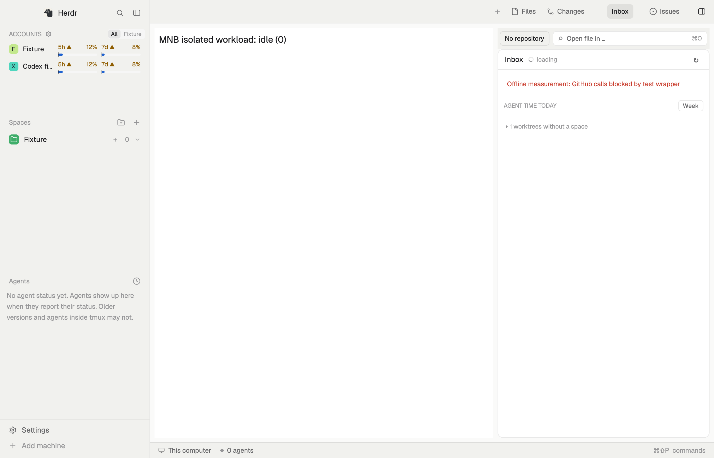
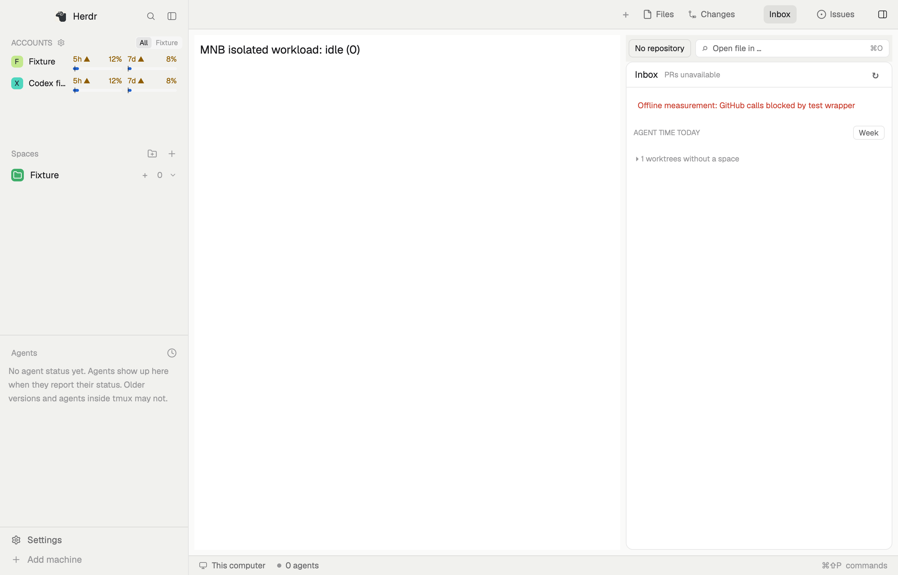

# Apple silicon Mac native measurement — 2026-11-02

The installed Herdr **0.1.12** app was measured on a **test Mac**, Apple M3 Pro (11 cores, 18 GB), macOS 27.2 (26B123). Relevo was absent initially. The user's app, terminals, accounts, keys and settings were not replaced. No cloud copy was removed; no other Mac or lab was used.

A reproduced failed-PR-query state kept a native spinner animating forever. [Draft PR #4](https://github.com/johnny4young/herdr-relevo/pull/4) fixes its lifecycle. In this case, fresh-process idle CPU fell from **6.73% to 2.15% of one core**; a reversal in the same process repeated **6.58% → 2.12%**, excluding ten settling seconds per variant. This supports a CPU reduction for this visible error state, not a general 68% app improvement. **No RAM improvement was demonstrated.**

## Original installed-app baseline

90 one-second samples, **15:37:27–15:38:56 UTC**, captured before installation or enabling Relevo. GUI RSS median **74.71 MiB**, peak **75.38 MiB**. CPU-time deltas give a **2.02% mean** of one core; the independently preserved `ps %CPU` median is 0.6%, which uses a different averaging window. Existing CLI agents' RSS median was **425.95 MiB**, peak 443.91 MiB, accounted for separately. TUI 0.9.5, core binary 0.1.17. See ambient-summary.json and metadata.json. These are aggregate results; the 90 ambient process records are retained only in the private local backup and are excluded from the public process archive.

Personal mod, layout and TUI-plugin inventories are retained only in the private local backup. This ambient observation cannot be compared directly with the instrumented fixture below: profile, content, process lifetime and memory residency differ.

## Controlled native fixture

Fresh HOME/XDG paths, HC_SESSION and HERDR_APP_HOME on this same Mac. Native HOME and child-shell HOME were verified before installation. All three phases completed **420 one-second samples**, four 60-second windows in three 20-second blocks and a 180-second window in three 60-second blocks. Each phase used a fresh GUI process and the same isolated core. These are consecutive windows, not three independently restarted replicas. Wall-clock order was baseline → original Relevo → correction; background Mac load was not controlled.

| Scenario | CPU baseline % | CPU Relevo % | CPU fixed % | RSS baseline MiB | RSS Relevo MiB | RSS fixed MiB |
| --- | ---: | ---: | ---: | ---: | ---: | ---: |
| Idle, offline Inbox visible in Relevo | 1.41 | 6.73 | 2.15 | 129.34 | 140.17 | 142.91 |
| Second resting window (Inbox only in Relevo) | 1.34 | 5.97 | 1.86 | 138.19 | 146.01 | 131.83 |
| Native 4000-line replacement + save/readback | 38.48 | 40.65 | 38.71 | 136.65 | 149.88 | 146.90 |
| Native diff-shaped text replacement | 57.99 | 60.43 | 58.51 | 137.56 | 158.80 | 157.84 |
| Alternating native workload, 180 seconds | 49.15 | 51.63 | 49.30 | 137.95 | 160.65 | 162.82 |

CPU comes from process CPU-time deltas, normalized to one core, for the GUI process alone. RSS is resident memory, not total footprint, heap size or summed physical memory. The same short-lived child can escape one-second sampling; raw process trees and core groups are preserved. Relevo adds a layout, dependencies and polling: the comparison measures their combined no-account fixture cost. It does not isolate each mod's allocation.

The two resting modes use the same blank main view; Relevo's Inbox is visible in both. The shipped baseline has no Inbox, so its second resting window is **not a functional Inbox comparison**. Editor and diff-shaped text workloads use an identical native GPUI benchmark component in every phase; they are **not a measurement of Relevo's editor/review interactions**. Replacing all 4000 lines once per timer tick is a stress input, not typing latency or FPS.

Recorded native workload operations: **210 per phase, zero readback errors** (40 edit-save, 40 diff-text, 130 sustained). Logs flush every ten operations, so the final incomplete group is intentionally absent. Edit/save median/p95: baseline **474/484 ms**, original Relevo **478/484 ms**, correction **478.5/485 ms**. This includes full-text replacement, native save and readback; no meaningful improvement in that latency was established. Operation samples are correlated and too few to certify tail latency. Status-command latency is in native-summary.json; it is not input-to-present latency.

Baseline: **15:59:22–16:06:24 UTC**, original Relevo **16:08:24–16:15:26**, correction **16:16:59–16:24:01**. Completion seals include hashes of the original local raw files. A failed metrics-log pilot, 15:51–15:58, was retained locally and excluded from paired results; its logger omitted the host expected-text argument. The corrected logger was validated before the final baseline.

The spinner reversal held the same GUI PID, layout, no-account error and fixture adapter. Each variant ran 70 seconds, discarding the first ten; 60 samples each remained. Original **6.5769%**, correction **2.1186%** mean CPU. RSS medians 172.74/171.88 MiB are not evidence of a RAM reduction: reload history and residency differ. No leak conclusion follows from these short runs.

## Installation and privacy limits

Source **b53664ac8ab62ad0f2ecbaf756048329c435e84a**, dependencies space-folders **aad4a3472d21e5df9de28d1506807e8fc3ca8c47**, issues **5b68adc328fc541d2a5ad12df999cd045ec4883a**. The non-overwriting installer refused to run without the completed baseline. All five native mod checks passed. There were no key collisions in the test profile. See isolated-install-manifest.json for copied-file hashes.

Installation is **only in `/tmp/hmnb-20261102/app`**, with cloned sources in the task workspace; **the personal Herdr profile was not enabled or configured**. The test copy of quota.js explicitly returns an empty collection; synthetic quota snapshots populate the bars. Production quota.js is unchanged in Git. Security and gh wrappers prevent Keychain/GitHub access, HOME contains no real auth/history, inherited API token variables were removed, configured launcher strings were set to false and no launcher was invoked; no Claude/Codex model tests were started. Authenticated quota collection, populated PR lists, histories, accounts and live Inbox agents are unmeasured. No authentication flow or security setting was changed.

Correction source: local commit 654a80bbbacaf0e70e51a0bbcee2c346f3f221b2 and published PR #4 commit **03363101e20accfd0109d307d10757d9f14429d8** have the identical tree **9f2d801e628e5679f79bddb7015d555c1089a844**. Only inbox.js/inbox-prs.js changed in the installed copy. No proposal was merged or deployed to the personal profile.

## Verification and remaining blockers

Six new source-level scan/header regressions: five fail on main, all six pass with the correction. macOS Node 24.21.0: correction Relevo **56/56**, files **6/6**, Python hooks **11/11**; ESLint 10.13.0 and whitespace check passed. [Node-26 CI on exact PR #4 head](https://github.com/johnny4young/herdr-relevo/actions/runs/41480050189) passed. Existing PR #1 and #2 source snapshots also passed their independent suites on this Mac (84 and 69 tests respectively); neither was assumed merged. Their combined cloud result of 86 tests is historical, not a claim of a combined native GUI validation.

A supplemental native-host probe used an unchanged, hash-verified copy of FileEditor, with **10 bounded load/edit/save/readback cycles and zero errors**. It rendered native editor controls and did not deliver keyboard/pointer events or test concurrency races. The source-level asynchronous regressions remain in PR #1. The actual relevo-files view rendered its 4000-line fixture and the actual review view eventually displayed the changed-file list and diff. Its initial screenshot was premature while loading, not a demonstrated Git error; native Git diagnostics returned the expected +4000/-4000 numstat. Review caps rendering at 4000 rows, so full 8000-row diff fidelity was not verified. Twenty Files/Inbox panel changes had zero command errors, median reply 11.24 ms and max 21.58 ms; these are command acknowledgements, not frame presentation times. Native probe JSON is included; full file/editor/diff screenshots remain with the local evidence. The public images below show the spinner states.

Creating a terminal in the isolated **baseline before Relevo** repeatedly stopped answering (`terminal.run: no reply from core`). Initial sandbox launches recorded Operation not permitted. Recovery was restricted to individually verified test processes. A batch termination was initially rejected because one PID was not sufficiently identified; after the process command and socket ownership were verified, the scoped recovery was approved. No personal core was stopped. This is an app/core/environment blocker, not a demonstrated Relevo defect. **Live Claude/Codex integration, agent-driven Inbox answers, real keyboard typing/scrolling FPS and hours-long use remain unverified.** There is no promise of permanent smoothness.

## Raw evidence and reproduction

process-samples.jsonl.gz contains **1,400 dated records**: 1,260 from the three controlled native phases (420 each) and 140 from the reversal (70 per variant, including settling samples). The 90 ambient process records and personal inventories are excluded; the complete 1,490-record original and raw evidence remain in a hash-verified private local backup. The machine label is generic; hardware and software versions remain available for reproduction. Only executable basenames are published; the original executable paths and immutable raw JSONL remain in the task workspace. No argv, environments, session/terminal content or credentials were captured. This minimization is a normal follow-up commit: earlier Git history remains unchanged. SHA256SUMS.json covers the current public evidence; local completion seals hash their original files, so their hashes differ from sanitized/recombined publication.

The scripts in `scripts/mnb/` record the executed workload, installer guard, sampler, aggregate calculation, reversal and native FileEditor probe. They target this explicitly isolated fixture; do not point them at a personal profile. The launcher creates no terminals, removes token environment variables for its child only, and uses HERDR_APP_HOME plus HC_SESSION and scratch XDG paths. To recreate the baseline, launch the installed 0.1.12 binary with a fresh short fixture path, copy native-workload into its mods, clone its generated main layout into the five `mnb-baseline-<mode>` layouts replacing the active-tab content with `{mod:"mnb-workload",props:{mode,run:"baseline-"+mode}}`, then run run_native_comparison.py with the verified GUI/core PIDs. Install with install_isolated.py only after the baseline completion seal; use the same durations for Relevo and the correction. The original source, fixture-only quota adapter and modified configuration are explicit in that installer. Keep its logs and confirm sample counts, GUI PID presence and readback results before drawing conclusions.

