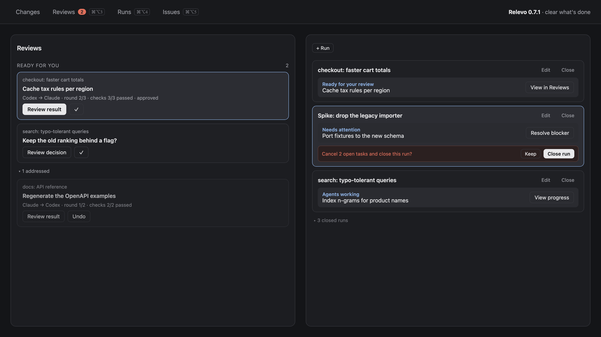

# Release announcements

Ready-to-post texts for each Relevo release, newest first.

## v0.7.1 — 2026-11-11

Runs and reviews you've dealt with can now leave the panel, and Runs gets its own key.



### X / Bluesky — 228 characters

Relevo 0.7.1 for Herdr: a ✓ hides a ready review until its task returns a new revision. It never accepts anything. Close cancels a run's open tasks after asking, and closed runs fold away. ⌘⌥4 opens Runs. https://github.com/johnny4young/herdr-relevo/releases/tag/v0.7.1

### Platform notes

> Closing a run leaves the worktrees of its cancelled tasks; remove them from the run window. Existing installs need the three `cmd-alt-3/4/5` lines from `keys.json` merged into their own.

### Links

- Release: https://github.com/johnny4young/herdr-relevo/releases/tag/v0.7.1
- Repo: https://github.com/johnny4young/herdr-relevo
- Update from a clone:

```sh
rsync -a --exclude config.js mods/relevo/ ~/.config/herdr-app/mods/relevo/
```
